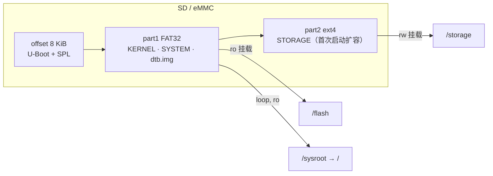
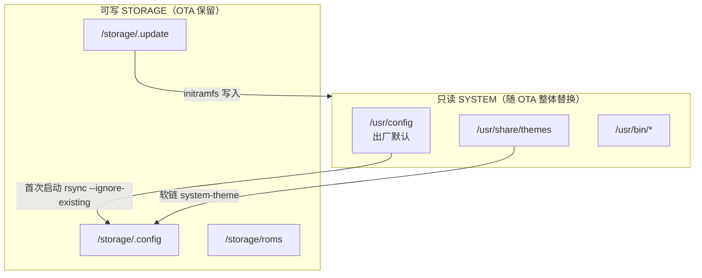

# 02 · 分区与目录结构

> 基线：`next` @ `742bd52562`。`[事实]` 附 `文件:行号`；`[推断]` 为推导；`[待验证]` 需真机。

## 1. 分区布局

`[事实]` 镜像由 `scripts/mkimage` 生成，H700 使用 **msdos** 分区表、两个分区：

| 分区 | 文件系统 | 大小（构建时） | 内容 | 挂载点 |
|---|---|---|---|---|
| 1 | FAT32 | `SYSTEM_SIZE=2048` MiB，起始扇区 `32768` | `KERNEL`、`SYSTEM`（squashfs）、`dtb.img`、`device_trees/`、`overlays/`、`extlinux/` 或 `boot.scr` | `/flash`（ro） |
| 2 | ext4 | `STORAGE_SIZE=32` MiB（首次启动扩容到整卡） | 用户数据、配置、ROM、存档、更新缓存 | `/storage`（rw） |

证据：

- `scripts/mkimage:16-23`（`SYSTEM_SIZE`/`STORAGE_SIZE` 计算磁盘大小）
- `scripts/mkimage:71-86`（创建 FAT32 + ext4 两个分区，part1 设 boot 标志）
- `scripts/mkimage:101`（STORAGE 卷标 `DISTRO_DISKLABEL`）
- `scripts/mkimage:112-118`（写入 `.please_resize_me` 标记）
- `distributions/ROCKNIX/options:190-196`（`SYSTEM_SIZE=2048`、`SYSTEM_PART_START=32768`、`STORAGE_SIZE=32`）



`[事实]` 首次启动由 `fs-resize.service` 执行 `/usr/lib/rocknix/fs-resize`：检测 `/storage/.please_resize_me`，若 `/storage/.config` 或 `.cache` 已存在则拒绝扩容并重启；否则用 `parted`/`resize2fs` 扩展第 2 分区（`projects/ROCKNIX/packages/sysutils/busybox/scripts/fs-resize:14-60`）。

`[事实]` 根文件系统是 squashfs，**只读**；`SYSTEM` 由 `mksquashfs` 生成（`scripts/image:246`），压缩算法可配（`SQUASHFS_COMPRESSION`，默认 gzip）。

## 2. 挂载点与读写属性

| 挂载点 | 来源 | 读写 | 说明 | 证据 |
|---|---|---|---|---|
| `/flash` | part1 FAT32 | ro（更新时临时 rw） | 内核、SYSTEM、DTB | `init:706`、`update_file():393-408` |
| `/` | part1 `/SYSTEM` squashfs（loop） | ro | 整个发行版系统 | `init:281-288`、`init:1372` |
| `/storage` | part2 ext4 | rw | 全部用户数据 | `init:732` |
| `/var` | tmpfs | rw（内存） | 运行时状态 | `packages/sysutils/busybox/system.d/var.mount` |
| `/var/log` | `/storage/.cache/log` bind | rw | 仅在调试条件满足时持久化 | `packages/sysutils/busybox/system.d/var-log.mount` |
| `/run` | tmpfs（20% 内存） | rw | 运行时目录 | `init:29` |
| `/storage/roms` | 内部/外部卡 bind 或 overlay | rw | 游戏库 | `projects/ROCKNIX/packages/rocknix/sources/scripts/automount:38-100` |

`[事实]` `/usr/lib/modules` 与 `/usr/lib/firmware` 不是实体目录，而是指向 `/run/kernel-overlays/...` 的软链（`scripts/image:220-223`），即内核模块按设备/内核版本在运行时选择。

## 3. 目录树（运行时视角）

```text
/
├── flash/                  # FAT32 启动分区（ro）
│   ├── KERNEL
│   ├── SYSTEM              # squashfs 镜像文件
│   ├── dtb.img
│   ├── device_trees/
│   └── overlays/
├── storage/                # ext4 数据分区（rw）
│   ├── .config/            # 用户配置（首次启动从 /usr/config 复制）
│   │   ├── emulationstation/   # es_settings、themes、locale 软链
│   │   ├── retroarch/          # RetroArch 配置、saves、states
│   │   ├── profile.d/          # 平台/设备 quirk 导出的环境变量
│   │   ├── autostart/          # 用户自定义启动脚本
│   │   └── system/             # 系统级可写配置（system.cfg 等）
│   ├── .cache/             # 缓存、日志、machine-id、rfkill
│   ├── .emulationstation/  # ES 运行期设置（es_settings.cfg 等）
│   ├── .update/            # OTA 下载暂存（重启后由 initramfs 应用）
│   ├── roms/               # 游戏库（bind/overlay 自 games-*）
│   │   ├── bios/           # BIOS（RetroArch system_directory）
│   │   ├── screenshots/
│   │   └── <system>/       # 各平台 ROM
│   ├── games-internal/     # 内部存储游戏目录
│   ├── games-external/     # 外部 TF 卡游戏目录
│   ├── music/  videos/  pictures/  recordings/
│   ├── joypads/            # 手柄映射
│   ├── overlays/           # 着色器/覆盖层
│   └── logfiles/           # 诊断日志
├── usr/                    # squashfs（ro）
│   ├── bin/                # emulationstation、runemu.sh、autostart…
│   ├── config/             # 出厂默认配置（复制到 /storage/.config）
│   ├── share/themes/       # 系统主题（软链到 /storage/.config/emulationstation/themes/system-theme）
│   └── lib/rocknix/        # 平台脚本
├── etc/                    # squashfs（ro），部分文件软链到 /storage
├── var/                    # tmpfs
└── run/                    # tmpfs，含 /run/rocknix/start.games
```

## 4. 用户数据与 OTA 的关系

`[事实]` OTA 只替换 `/flash` 下的 `KERNEL`、`SYSTEM`（以及 bootloader/DTB），**不触碰 `/storage`**：

- 更新文件放在 `/storage/.update`（`rocknix-update:88-98`）
- initramfs 在 `check_update` 阶段把 `KERNEL`、`SYSTEM` 写入 `/flash`（`init:1125-1128`、`update_file():393-408`）
- `factoryreset` 明确保留 `.update`、`roms`、`games-*`（`projects/ROCKNIX/packages/rocknix/sources/scripts/factoryreset:108`）

`[事实]` 出厂默认配置与用户配置分离：

- `/usr/config/*` 是只读默认值；`userconfig-setup` 在首次启动时 `rsync --ignore-existing` 到 `/storage/.config`（`.../systemd/scripts/userconfig-setup:12-21`）
- `es_features.cfg`、`es_systems.cfg` **不复制**，而是软链回 `/usr/config/emulationstation/`，使 OTA 更新能直接生效（`userconfig-setup:48-56`）
- 系统主题 `system-theme` 软链到 `/usr/share/themes/es-theme-art-book-next`，随系统更新（`userconfig-setup:34-37`）



## 5. 结论

1. `[事实]` 系统是“**只读系统 + 可写数据**”两分：所有系统文件在 squashfs，用户数据在 ext4；OTA 以替换镜像文件的方式更新系统。
2. `[事实]` `/storage/.config` 是唯一的用户配置根；`/storage/roms` 是唯一的游戏内容根；两者都不参与 OTA。
3. `[事实]` `es_systems.cfg`/`es_features.cfg` 与系统主题是**软链**，所以修改它们不会持久化，OTA 会覆盖；真正可持久化的自定义应放在 `/storage/.config` 的其他文件或 `/storage/roms`。
4. `[推断]` 因为 `/var` 是 tmpfs，任何写入 `/var` 的状态（除 `/var/log` 在调试时 bind 到 storage）在重启后都会丢失；需要持久化的状态必须显式写到 `/storage`。
5. `[待验证]` `/storage/roms` 的 bind/overlay 选择依赖 `system.merged.storage` 与 `system.merged.device` 设置，实际默认值需在真机 `system.cfg` 中确认。
