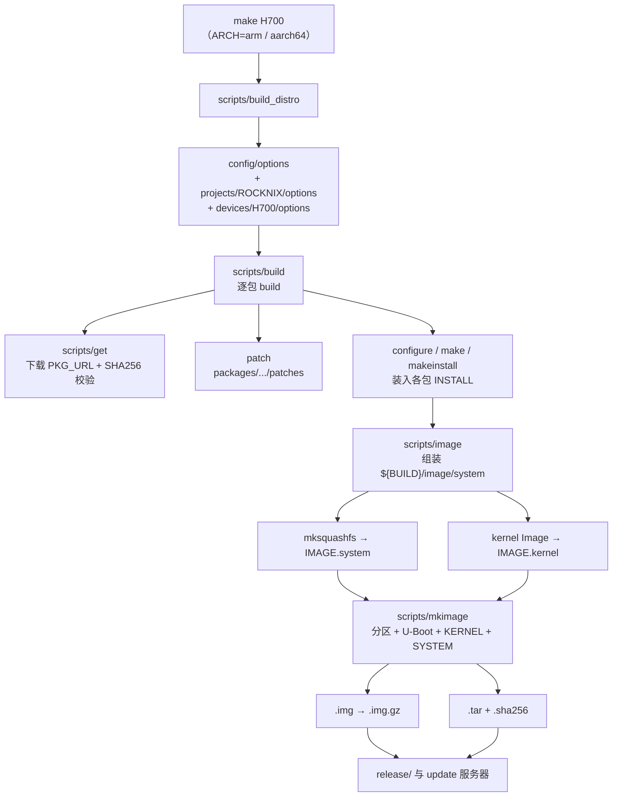

# 03 · 构建系统

> 基线：`next` @ `742bd52562`。`[事实]` 附 `文件:行号`。

## 1. 结论先行

`[事实]` ROCKNIX **不是 Buildroot，也不是 Yocto**，而是 LibreELEC/CoreELEC 派生的一套自研 shell 构建脚本：

- 入口 `Makefile` 按 SoC 调用 `scripts/build_distro`（`Makefile:31-80`）
- 包管理不是 `.bb`/`Config.in`，而是每个包一个 `package.mk`（shell 变量 + 函数）
- rootfs 由 `scripts/image` 用 `fakeroot` 组装，`mksquashfs` 生成 `SYSTEM`
- 磁盘镜像由 `scripts/mkimage` 分区、写引导、合并 SYSTEM 与 STORAGE

## 2. 构建流程



| 阶段 | 脚本 | 关键行为 | 证据 |
|---|---|---|---|
| 入口 | `Makefile` | `H700: scripts/build_distro`（arm + aarch64 各一次） | `Makefile:70-80` |
| 环境 | `scripts/build_distro` | 载入 `config/options`、项目/设备 options；按需清理包 | `scripts/build_distro:15-75` |
| 单包构建 | `scripts/build` | 解析 `PKG_DEPENDS_TARGET`，递归构建依赖 | `scripts/build:64`、`:283-290` |
| 下载 | `scripts/get` | `PKG_URL` + `PKG_SHA256` 校验后解包到 `sources/` | `scripts/get` |
| rootfs | `scripts/image` | `fakeroot` 下组装 `/usr`、`/etc`、systemd 链接 | `scripts/image:190-250` |
| squashfs | `scripts/image` | `mksquashfs ... -comp gzip`（可配 zstd/lzo） | `scripts/image:233-246` |
| 磁盘镜像 | `scripts/mkimage` | msdos 分区表、FAT32 + ext4、写 U-Boot | `scripts/mkimage:64-118` |
| 发布 | `scripts/image` | `.img.gz`、`.tar`、`.sha256` | `scripts/image:296-315` |

## 3. 包定义模型

`[事实]` 每个包是 `packages/<section>/<name>/package.mk`（或 `projects/ROCKNIX/packages/...` 覆盖），核心变量：

```sh
PKG_NAME="emulationstation"
PKG_VERSION="f6c5428..."
PKG_SHA256="605f54..."
PKG_SITE="https://github.com/ROCKNIX/emulationstation-next"
PKG_URL="${PKG_SITE}/archive/${PKG_VERSION}.tar.gz"
PKG_DEPENDS_TARGET="boost toolchain SDL2 freetype curl ..."
PKG_CMAKE_OPTS_TARGET+=" -DROCKNIX=1 ..."
makeinstall_target() { ... }
```

证据：`projects/ROCKNIX/packages/ui/emulationstation/package.mk:4-23`。

`[事实]` 包集合由**元包**决定，而不是逐包开关：

- `projects/ROCKNIX/packages/virtual/image/package.mk`：根元包，`PKG_DEPENDS_TARGET` 列出系统基础、UI、多媒体、网络等（`.../virtual/image/package.mk:11-33`）
- `projects/ROCKNIX/packages/virtual/emulators/package.mk`：`PKG_EMUS`、`PKG_RETROARCH`、`LIBRETRO_CORES` 三组清单（`.../virtual/emulators/package.mk:11-30`）
- `projects/ROCKNIX/packages/virtual/gamesupport/package.mk`：手柄/热键/触摸键盘等辅助包（`.../virtual/gamesupport/package.mk:9-21`）

`[事实]` 设备可以追加包：H700 的 `ADDITIONAL_PACKAGES="handheld-launcher xmplayer adbd"`（`projects/ROCKNIX/devices/H700/options:72`）。

## 4. 如何新增 / 删除软件包

### 新增

1. `[事实]` 在 `packages/<section>/<name>/package.mk`（或项目级 `projects/ROCKNIX/packages/...`）写包定义，提供 `PKG_URL`/`PKG_SHA256`/`PKG_DEPENDS_TARGET`/`makeinstall_target`。
2. `[事实]` 把包名加入某个元包的 `PKG_DEPENDS_TARGET`，或设备的 `ADDITIONAL_PACKAGES`（H700 示例见上）。
3. `[事实]` 需要 systemd 单元时放 `system.d/*.service`，构建时由 `enable_service` 建立 `WantedBy` 链接（`packages/sysutils/busybox/package.mk:157-168`）。
4. `[事实]` 需要默认配置时放 `config/`，由 `makeinstall_target` 复制到 `${INSTALL}/usr/config`，首次启动再进入 `/storage/.config`（见 02 文档）。

### 删除

1. `[事实]` 从元包依赖中移除包名（`virtual/image`、`virtual/emulators` 或 `ADDITIONAL_PACKAGES`）。
2. `[事实]` 若包被 `CLEAN_*` 列表引用，也要同步清理（`distributions/ROCKNIX/options:44-50`）。
3. `[事实]` 删除该包目录及其在 `config/emulators/*.conf`、`es_features.cfg` 中的引用（否则 ES 仍会显示不可用的系统/核心）。

`[推断]` 因为包集合是“元包 + 设备追加”的静态列表，裁剪发行版时**不需要改构建框架**，只需维护这些列表；但漏删 `es_features.cfg`/`es_systems.cfg` 会产生“菜单里存在、启动即失败”的条目。

## 5. rootfs 与镜像生成

`[事实]` rootfs 不是逐包安装到磁盘，而是：

1. 每个包把文件装到自己的 `${INSTALL}`；
2. `scripts/image` 把所有 `${INSTALL}` 合并为 `${BUILD}/image/system`（含 `/usr`、`/etc`、systemd 单元链接）；
3. `mksquashfs` 生成 `${IMAGE_NAME}.system`；
4. `scripts/mkimage` 把 `KERNEL`、`SYSTEM`、`dtb.img`、`overlays/` 写入 FAT32 启动分区，把空的 ext4 STORAGE 写入第二分区；
5. 发布阶段生成 `.img.gz`（整盘）与 `.tar`（升级包）+ `.sha256`。

`[事实]` 内核与模块分离：模块在 `/usr/lib/kernel-overlays/`，运行时软链到 `/run/kernel-overlays`（`scripts/image:208-223`）。

## 6. 构建系统的边界

| 能力 | 是否有 | 证据 |
|---|---|---|
| 交叉编译工具链 | 有（`toolchain` 包） | `packages/virtual/toolchain`、`scripts/build` |
| 二进制包缓存 | 有（`sources/`、`build.*`） | `.gitignore`、`scripts/get_archive` |
| 依赖自动解析 | 有（`PKG_DEPENDS_TARGET` 递归） | `scripts/build:64` |
| 版本锁定 | 有（`PKG_VERSION` + `PKG_SHA256`） | 各 `package.mk` |
| 增量构建 | 有（`.stamps`） | `build.*/image/.stamps` |
| 可选的包开关 | 部分（options 变量 + 元包条件） | `virtual/image/package.mk:35-100` |
| 运行时包管理 | 无（只读 squashfs） | 见 02 文档 |

## 7. 结论

1. `[事实]` 构建系统是“LibreELEC 风格脚本 + package.mk”，学习成本主要在 shell 变量与元包列表，而不是 Yocto 的 layer/recipe 体系。
2. `[事实]` 裁剪/替换组件的最小改动面是：元包依赖列表、`ADDITIONAL_PACKAGES`、`config/emulators/*.conf`、`es_features.cfg`。
3. `[推断]` 因为 rootfs 是整体 squashfs，任何“删包”都必须重新构建并整包 OTA，不能像 deb 系那样在线卸载。
4. `[待验证]` 完整构建耗时与产物体积未在本机复现（仓库无完整构建产物），需要一次真实 `make H700` 才能给出数字。
