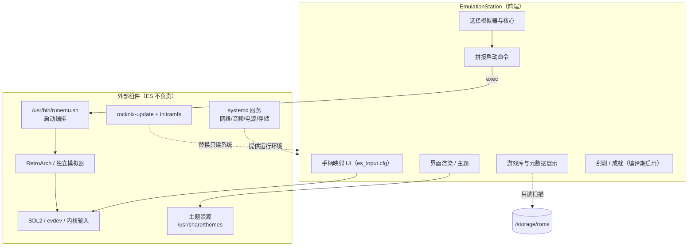

# 04 · EmulationStation 的职责边界

> 基线：`next` @ `742bd52562`。ES 源码在独立仓库 `ROCKNIX/emulationstation-next`，本仓库只包含**集成方式**；因此“ES 内部实现了什么”只能从构建参数、配置文件与调用约定推断，无法逐行审计。`[事实]` 均来自本仓库。

## 1. ES 是什么（集成视角）

| 项 | 事实 | 证据 |
|---|---|---|
| 上游仓库 | `ROCKNIX/emulationstation-next` | `projects/ROCKNIX/packages/ui/emulationstation/package.mk:8` |
| 固定版本 | `f6c542872e3850c5f432929ead219547a897cd4a` | 同上 `:5` |
| 构建标志 | `-DROCKNIX=1`、`-DDISABLE_KODI=1`、`-DENABLE_FILEMANAGER=0`、`-DCEC=0`、`-DENABLE_PULSE=1`、`-DGLES3=1` | 同上 `:18-23` |
| 可选能力 | `BATTERYPLUS`（按设备）、抓取源凭据（ScreenScraper / TheGamesDB / RetroAchievements） | 同上 `:25`、`:29-37` |
| 依赖 | Boost、SDL2、FreeType、curl、FreeImage、RapidJSON、SDL2_mixer、ffmpeg/VLC、poppler、pugixml、Noto CJK 字体等 | 同上 `:11` |

`[事实]` 抓取与成就支持是**编译期**决定的：`pre_configure_target()` 检查 `SCREENSCRAPER_DEV_LOGIN`、`GAMESDB_APIKEY`、`CHEEVOS_DEV_LOGIN`，未声明则打印警告并且不编译对应支持（`package.mk:29-37`）。

## 2. ES 读取的配置

| 文件 | 作用 | 来源 |
|---|---|---|
| `es_systems.cfg` | 系统列表：名称、ROM 路径、扩展名、启动命令、平台、主题 | **构建时生成**（见 §3） |
| `es_features.cfg` | 每个模拟器/核心的可调选项（shader、分辨率、bios 等） | `projects/ROCKNIX/packages/ui/emulationstation/config/common/es_features.cfg` |
| `es_input.cfg` | 手柄映射（按 `deviceGUID` 匹配） | `.../config/common/es_input.cfg` |
| `es_settings.cfg` | 用户 UI 设置 | 运行期 `/storage/.emulationstation/es_settings.cfg`（`runemu.sh:36`） |
| 主题目录 | 主题 XML + 图片/字体 | `/storage/.config/emulationstation/themes/` |

`[事实]` `es_features.cfg` 有 366 个 `<feature>` 条目，按 `emulator`/`core` 分组（例如 `nes` 的 `correct_aspect`、`clipsides`、`no8lim`），说明 ES 菜单里的“高级选项”来自这个静态 XML，而不是运行时探测模拟器能力。

## 3. 系统列表是构建产物，不是运行时扫描

`[事实]` `es_systems.cfg` 在 `projects/ROCKNIX/packages/virtual/emulators/package.mk` 的 `makeinstall_target()` 中生成：

1. 先 `add_emu_core <system> <emulator> <core> <default>` 注册可用核心（如 `add_emu_core nes retroarch fceumm true`）
2. 再 `add_es_system <system>` 生成 `<system>` 节点
3. 最后由 `mk_es_systems` 汇总为完整 XML

证据：`.../virtual/emulators/package.mk:125-160`、`distributions/ROCKNIX/config/functions:82-140`、`:121-140`。

`[事实]` 每个系统的元数据来自 `config/emulators/<system>.conf`（139 个文件），例如 `nes.conf`：

```sh
SYSTEM_NAME="nes"
SYSTEM_PATH="/storage/roms/nes"
SYSTEM_EXTENSION=".nes .unif .unf .zip .7z"
SYSTEM_PLATFORM="nes"
SYSTEM_THEME="nes"
```
（`config/emulators/nes.conf:1-10`）

`[推断]` 因此 **ES 不做“发现已安装模拟器”这件事**：可用系统/核心在构建时写死。删掉一个模拟器包但不改 `es_systems.cfg`/`es_features.cfg`，ES 仍会显示该核心，启动时才失败。

## 4. ES 启动游戏时做了什么

`[事实]` `es_systems.cfg` 的默认命令模板是：

```sh
/usr/bin/runemu.sh %ROM% -P%SYSTEM% --core=%CORE% --emulator=%EMULATOR% --controllers="%CONTROLLERSCONFIG%"
```
（`distributions/ROCKNIX/config/functions:122`）

`[事实]` `tools` 系统例外：`SYSTEM_COMMAND="%RUNCOMMAND%"`，直接执行脚本（`config/emulators/tools.conf:7`）。

`[推断]` ES 的职责到“把 ROM 路径、系统名、选中的核心/模拟器、手柄配置拼成命令行”为止；真正的进程启动、性能模式切换、RetroArch 配置生成、日志、退出清理都在 `runemu.sh`（见 05 文档）。

## 5. 职责边界图



## 6. ES 负责 / 不负责（结论表）

| 能力 | 是否属于 ES | 依据 |
|---|---|---|
| 界面、主题渲染、动画 | ✅ 是 | ES 主题目录 + `-DGLES3=1` |
| 游戏库扫描（按 `es_systems.cfg` 的路径/扩展名） | ✅ 是 | `SYSTEM_PATH`/`SYSTEM_EXTENSION` |
| 元数据展示、刮削、成就 | ✅ 是（编译期开关） | `SCREENSCRAPER_DEV_LOGIN` 等 |
| 手柄映射 UI 与 `es_input.cfg` | ✅ 是 | `es_input.cfg` 按 GUID 匹配 |
| 选择模拟器/核心并拼命令行 | ✅ 是 | `runemu.sh %ROM% -P… --core=…` |
| 实际启动进程、性能模式、日志、清理 | ❌ 否 | `runemu.sh` |
| 模拟器/核心本身 | ❌ 否 | 独立包（RetroArch、`*-sa`） |
| 原始输入事件（evdev → SDL） | ❌ 否 | 内核 + SDL2 |
| 网络/蓝牙/音频/电源/存储挂载 | ❌ 否 | systemd 服务（见 09 文档） |
| 系统更新 | ❌ 否 | `rocknix-update` + initramfs（见 10 文档） |
| 主题资源本身 | ❌ 否（只消费） | `/usr/share/themes/es-theme-art-book-next` |

## 7. 可替换性判断（只陈述事实与约束）

`[事实]` ES 通过 systemd 服务启动（`essway.service` / `emustation.service`），并由 `UI_SERVICE` 变量选择；`start_es.sh` 是唯一的启动入口（`.../sources/start_es.sh`）。

`[事实]` ES 与系统之间只有四个契约：

1. 可执行文件路径 `/usr/bin/emulationstation`（或 `start_es.sh` 内的替代实现）
2. `es_systems.cfg` 的 XML schema 与 `runemu.sh` 命令行约定
3. `/storage/.emulationstation`、`/storage/.config/emulationstation` 两个配置目录
4. 主题目录结构

`[推断]` 因此替换 ES 的**技术边界**是“实现这四个契约”，而不是重写整个系统；但本报告不做替换设计（issue 明确要求）。

## 8. 未决问题

- ES 二进制内部是否还直接调用系统脚本（如更新、关机、重启）——需要读 `emulationstation-next` 源码或真机 `strace`，本仓库无法证明。
- `es_features.cfg` 中 366 个 feature 与 `runemu.sh` 的消费关系，需要在 05 文档中逐项对照。
