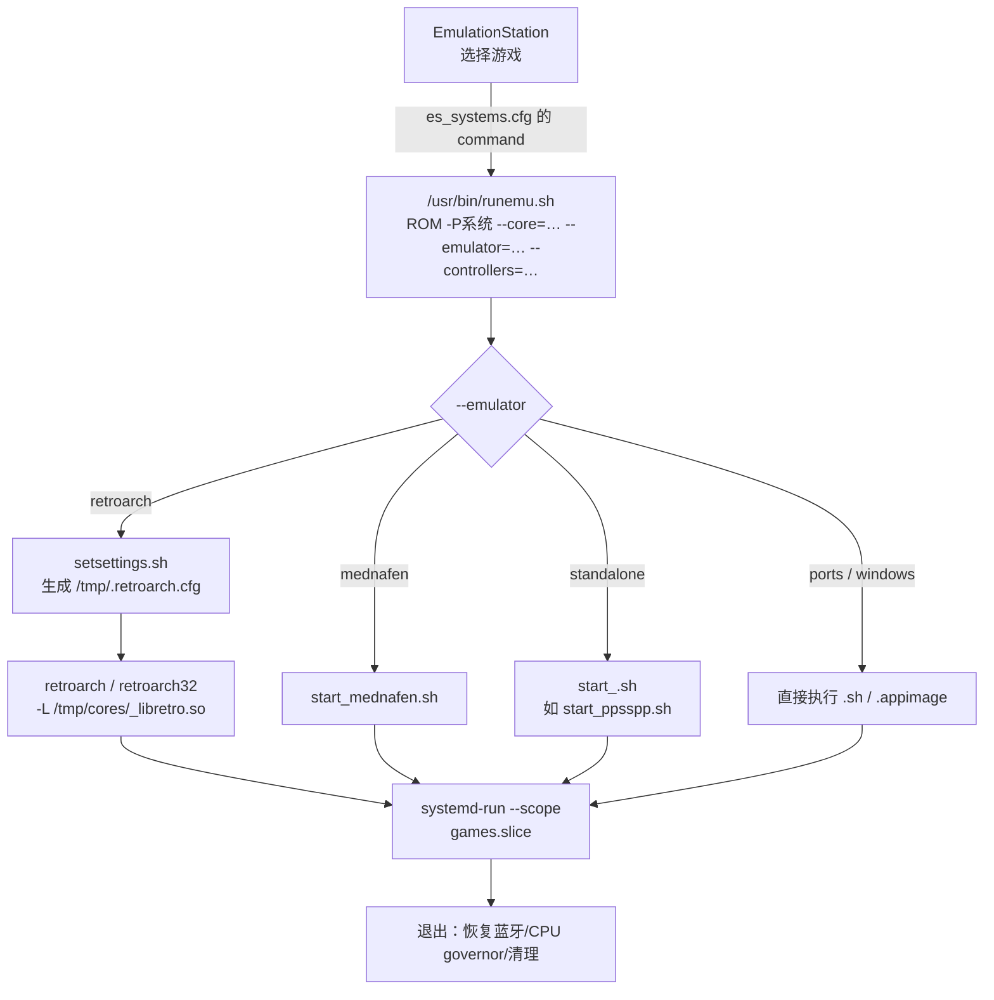

# 05 · 程序启动机制（选中游戏之后）

> 基线：`next` @ `742bd52562`。核心文件：`projects/ROCKNIX/packages/rocknix/sources/scripts/runemu.sh`（约 700 行）。

## 1. 调用链



## 2. 参数约定

`[事实]` ES 传入的命令模板（`distributions/ROCKNIX/config/functions:122`）：

```sh
/usr/bin/runemu.sh %ROM% -P%SYSTEM% --core=%CORE% --emulator=%EMULATOR% --controllers="%CONTROLLERSCONFIG%"
```

`[事实]` `runemu.sh` 用字符串截取解析参数（`runemu.sh:19-27`）：

| 变量 | 来源 |
|---|---|
| `PLATFORM` | `-P` 之后到空格 |
| `CORE` | `--core=` 之后 |
| `EMULATOR` | `--emulator=` 之后 |
| `ROMNAME` | `$1` |

`[推断]` 这意味着 ROM 路径、系统名、核心名不能包含未转义的空格/特殊字符；脚本依赖 `%ROM%` 由 ES 传入时已正确引用。

## 3. 启动前准备（retroarch 路径）

`[事实]` 进入模拟器前，`runemu.sh` 依次执行：

1. 读取 `system.loglevel`，决定是否写 `/var/log/exec.log`（`runemu.sh:170-186`）
2. `bluetooth disable`：如果用户设置启用了蓝牙，杀掉 `rocknix-bluetooth-agent`（`runemu.sh:145-162`）
3. `set_kill stop`：停止热键拦截（`runemu.sh:192`）
4. 按 `EMULATOR` 分支选择 `RUNTHIS`（`runemu.sh:196-365`）
5. RetroArch 分支：
   - 32 位核心（`pcsx_rearmed32`、`gpsp`、`desmume` 等）切换到 `retroarch32`（`runemu.sh:236-250`）
   - 调用 `/usr/bin/setsettings.sh <platform> <rom> <core> --controllers=… --autosave=… --snapshot=…`，输出到 `/tmp/shader`（`runemu.sh:302-305`）
   - 把 `setsettings` 的返回值插入 RetroArch 命令的 `--config` 之前（`runemu.sh:325-330`）
6. 生成最终命令（`runemu.sh:258`）：

```sh
${EMUPERF} /usr/bin/${RABIN} -L /tmp/cores/${CORE}_libretro.so \
  --config /storage/.config/retroarch/retroarch.cfg \
  --appendconfig /tmp/.retroarch.cfg "${ROMNAME}"
```

`[事实]` `EMUPERF` 由 `cores` 设置决定：`little` → `SLOW_CORES`，`big` → `FAST_CORES`（`runemu.sh:374-386`），即用 `taskset` 类包装把模拟器绑到大小核。

## 4. 独立模拟器路径

`[事实]` 非 RetroArch 的核心走 `start_<core>.sh`（`runemu.sh:360-364`）。以 PPSSPP 为例（`projects/ROCKNIX/packages/virtual/emulators/sources/Start PPSSPP.sh`）：

```sh
set_kill set "ppsspp"
SOURCE_DIR="/usr/config/ppsspp"; CONF_DIR="/storage/.config/ppsspp"
[ -d "${CONF_DIR}" ] || cp -rf ${SOURCE_DIR} ${CONF_DIR}
cp -f /storage/.config/SDL-GameControllerDB/gamecontrollerdb.txt \
      /storage/.config/ppsspp/assets/gamecontrollerdb.txt
/usr/bin/ppsspp
```

`[推断]` 独立模拟器的模式是“**配置目录首次复制 + 控制器数据库同步 + 直接执行**”，没有统一的参数抽象层；每个 `start_*.sh` 自己处理。

## 5. Ports / Windows 路径

`[事实]` `PLATFORM=ports` 时（`runemu.sh:343-352`）：

- `.appimage` → 直接执行
- 其他 → `bash <脚本>`
- 写 `/storage/.config/PortMaster/mapper.txt` 的 `ACTIVE_GAME`/`ACTIVE_PLATFORM`

`[事实]` 非 ports 的 `.sh` ROM（如 ScummVM/DOSBox 扫描脚本）在 `runemu.sh:616-620` 被直接执行，不进入 `game_scope`。

## 6. 进程隔离与资源控制

`[事实]` 实际执行通过 `game_scope()`（`runemu.sh:97-116`）：

```sh
systemd-run --scope --quiet --slice=games.slice --unit="game-$$" \
  -p StopPropagatedFrom=essway.service -p TimeoutStopSec=5s \
  -p TasksMax=infinity -p OOMPolicy=continue -- "$@"
```

- `games.slice`：游戏进程独立 cgroup，便于 OOM/资源统计
- `StopPropagatedFrom=essway.service`：ES 重启不会连带杀掉正在运行的游戏
- `oom_score_adj=500`：游戏比系统进程更容易被 OOM 选中
- `game_scope_stop()` 读取 `games.slice/memory.events` 判断是否 OOM 被杀（`runemu.sh:118-133`）

`[事实]` 退出时恢复：`bluetooth enable`、`set_kill set "emulationstation"`、恢复 CPU governor（`runemu.sh:135-140`）。

## 7. 结论

1. `[事实]` ES 只负责“选什么”，`runemu.sh` 负责“怎么启动”；两者通过固定命令行契约解耦。
2. `[事实]` RetroArch 的每游戏选项来自 `setsettings.sh` + `es_features.cfg`，最终落到 `/tmp/.retroarch.cfg` 的 `--appendconfig`，不修改用户主配置。
3. `[事实]` 游戏进程被放进 `games.slice`，并由 `StopPropagatedFrom` 与 ES 生命周期解耦。
4. `[推断]` 替换 ES 时，只要新前端能生成同样的 `runemu.sh` 参数，启动链路可以完全复用；反之若直接调用 RetroArch，会绕过性能模式、蓝牙管理、OOM 策略与日志。
5. `[待验证]` `setsettings.sh` 的具体映射逻辑（哪些 feature 映射到哪些 RetroArch 选项）未逐行审计，需单独读该脚本。
