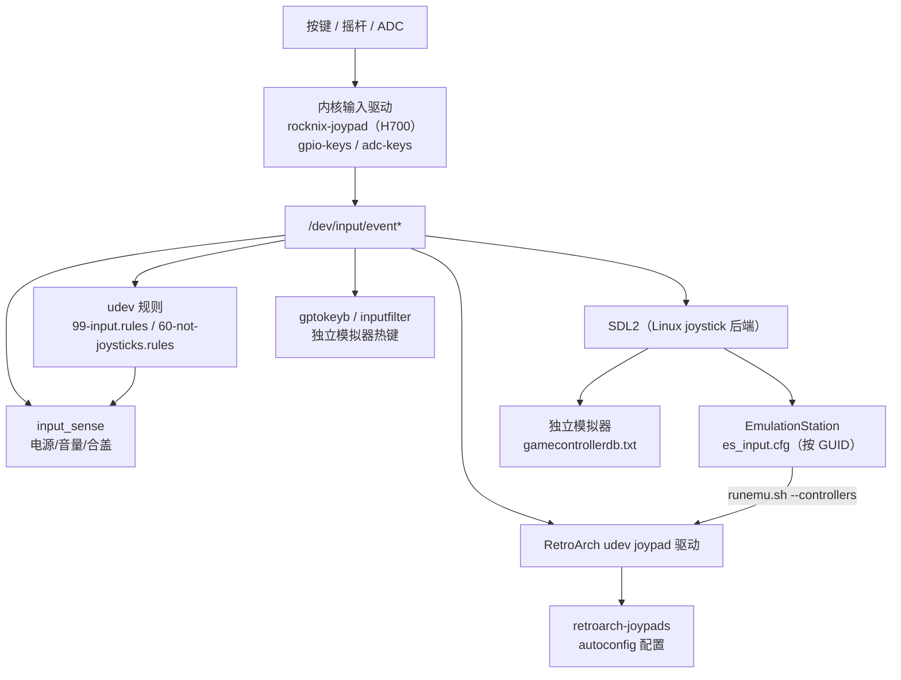

# 06 · 输入系统

> 基线：`next` @ `742bd52562`。以 H700 为例；其他 SoC 的差异在末尾说明。

## 1. 输入链路总览



## 2. 内核层

| 项 | 事实 | 证据 |
|---|---|---|
| 专用手柄驱动 | `rocknix-joypad` 内核模块（`PKG_IS_KERNEL_PKG="yes"`） | `projects/ROCKNIX/packages/linux-drivers/rocknix-joypad/package.mk:4-25` |
| 是否启用 | 发行版默认 `ROCKNIX_JOYPAD="yes"` | `distributions/ROCKNIX/options:52` |
| H700 按键/摇杆 | 设备树 + 驱动补丁（ADC 按键、PWM、force feedback） | `projects/ROCKNIX/devices/H700/patches/linux/0150-add-forcefeedback.patch` 等 |
| 电源/音量键 | 内核 `gpio-keys`/`adc-keys` 暴露为 `KEY_POWER`、`KEY_VOLUMEUP/DOWN` | `input_sense:27-40` 的匹配模式 |

`[事实]` H700 的设备文件系统目录没有 `inputplumber` 配置（对比 RK3566/SM8xxx 有 `filesystem/usr/share/inputplumber`），因此 H700 不走 InputPlumber 抽象层，而是直接用 `rocknix-joypad` 暴露的 evdev 设备。

## 3. udev 层

| 规则 | 行为 | 证据 |
|---|---|---|
| `99-input.rules` | `event*` 增加/变化/移除时 `killall input_sense`，由 systemd 重新拉起监听 | `projects/ROCKNIX/packages/sysutils/system-utils/udev.d/99-input.rules:5-7` |
| `60-not-joysticks.rules` | 把 `aml_keypad`、`Remote+` 从 `ID_INPUT_JOYSTICK` 中排除 | `.../systemd/udev.d/60-not-joysticks.rules:1-2` |
| `99-sixaxis.rules` | PS3 手柄插入时启动 `sixaxis@.service`，并删除 Motion Sensors 节点 | `packages/network/sixaxis/udev.d/99-sixaxis.rules` |
| `99-automount.rules` | 存储设备热插拔触发 automount | `projects/ROCKNIX/packages/virtual/emulators/udev.d/99-automount.rules` |

## 4. 用户态消费方

### 4.1 EmulationStation

`[事实]` ES 的手柄映射来自 `es_input.cfg`，以 `deviceGUID` 匹配设备，每个 `<input>` 指定 `name/type/id/value`：

```xml
<inputConfig type="joystick" deviceName="InputPlumber GameController"
             deviceGUID="0300f5a35e040000120b000001000000">
  <input name="a" type="button" id="1" value="1" />
  <input name="down" type="hat" id="0" value="4" />
  <input name="leftanalogleft" type="axis" id="0" value="-1" />
  ...
</inputConfig>
```
（`projects/ROCKNIX/packages/ui/emulationstation/config/common/es_input.cfg:2-16`）

`[事实]` ES 通过 SDL2 读取手柄；SDL 的设备数据库由 `gamecontrollerdb` 包提供，安装到 `/usr/config/SDL-GameControllerDB/gamecontrollerdb.txt`，首次启动软链到 `/storage/.config/SDL-GameControllerDB/gamecontrollerdb.txt`（`packages/apps/gamecontrollerdb/package.mk:16-22`、`userconfig-setup:40-44`）。

### 4.2 RetroArch

`[事实]` RetroArch 使用自己的 udev joypad 驱动 + autoconfig 配置：`retroarch-joypads` 包把 `linuxraw/sdl2/udev/x/xinput` 的 `.cfg` 安装到 `/usr/share/libretro/autoconfig`，并把 joypad 挂载为 `tmp-joypads.mount`（`.../retroarch-joypads/package.mk:15-25`）。

`[推断]` ES 的 `--controllers="%CONTROLLERSCONFIG%"` 参数把 ES 当前手柄配置传给 `runemu.sh`，后者写入 RetroArch append config；这使 ES 的映射与 RetroArch 的 autoconfig 可以叠加，而不是二选一。

### 4.3 独立模拟器

`[事实]` 独立模拟器通过 `SDL_GameControllerDB` 或 `gptokeyb` 获取映射，例如 PPSSPP 启动脚本复制 `gamecontrollerdb.txt` 到自己的 assets 目录（`Start PPSSPP.sh:16-17`）。

`[事实]` `rocknix-hotkey` 提供 `gptokeyb` 与 `inputfilter.so`，用于把手柄按键翻译成键盘事件（给只支持键盘的老游戏/模拟器），配置在 `/usr/config/gptokeyb/default.gptk`（`projects/ROCKNIX/packages/apps/rocknix-hotkey/package.mk:4-22`）。

### 4.4 系统级按键

`[事实]` `input_sense` 是一个常驻 evdev 监听器（`evtest` 流式读取），负责：

- 音量键 → 调整音量
- 电源键短按/长按 → 关机/重启/休眠
- 合盖 `SW_LID` → 休眠
- 同时监听 `hci*`（蓝牙）变化并重启自身

证据：`projects/ROCKNIX/packages/sysutils/system-utils/sources/scripts/input_sense:27-60`、`:180-210`。

## 5. libinput / Wayland 的位置

`[事实]` H700 的 `WINDOWMANAGER="swaywm-env"`（`projects/ROCKNIX/devices/H700/options:47`），Sway 通过 `seatd` + libinput 管理**指针/触摸**输入（`packages/wayland/lib/seatd/system.d/seatd.service`）。

`[推断]` 手柄不经过 libinput：SDL2 与 RetroArch 都直接读 `/dev/input/event*`；libinput 只影响触摸屏、鼠标、触控板。这意味着“手柄按键无反应”应查 evdev/驱动，而不是 libinput 配置。

## 6. 输入相关结论

1. `[事实]` H700 的输入主路径是“内核 `rocknix-joypad` → evdev → SDL2/RetroArch 各自读取”，没有统一的输入守护进程。
2. `[事实]` 映射数据分散在三处：`es_input.cfg`（ES）、`/usr/share/libretro/autoconfig`（RetroArch）、`gamecontrollerdb.txt`（SDL 应用）。
3. `[事实]` 系统级按键（电源/音量/合盖）由 `input_sense` 单独处理，和游戏输入互不依赖。
4. `[推断]` 更换前端时，如果新前端用 SDL2，则 `gamecontrollerdb` + `es_input.cfg` 的 GUID 映射可以复用；若新前端直接读 evdev，需要自己实现映射。
5. `[待验证]` `rocknix-joypad` 具体暴露的按键码与 H700 各机型（RG35XX Plus/H/2024 等）的差异，需要真机 `evtest` 确认。
