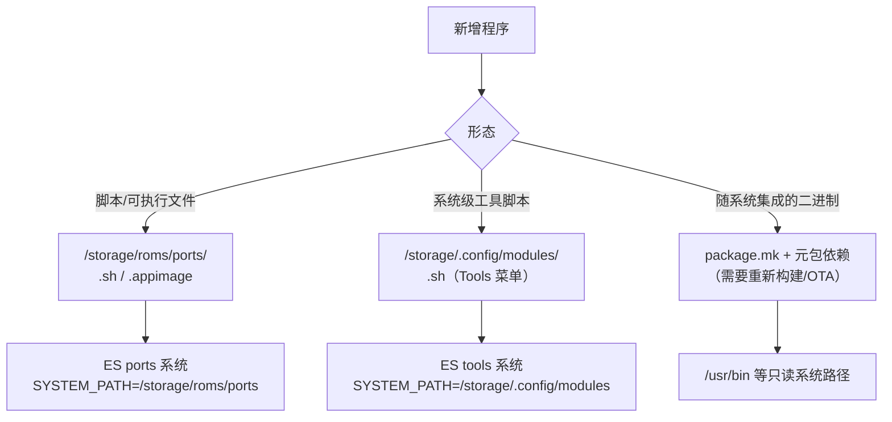

# 08 · 应用扩展机制

> 基线：`next` @ `742bd52562`。回答“新增一个程序最简单的方式、系统如何发现它”。

## 1. 三条接入路径



## 2. 路径一：Ports（最简单的用户级接入）

`[事实]` ES 内置 `ports` 系统：

```sh
SYSTEM_NAME="ports"
SYSTEM_PATH="/storage/roms/ports"
SYSTEM_EXTENSION=".sh .appimage"
SYSTEM_THEME="ports"
```
（`config/emulators/ports.conf:1-10`）

`[事实]` 选中后由 `runemu.sh` 的 `PLATFORM=ports` 分支处理（`runemu.sh:343-352`）：

- `.appimage` → 直接执行
- 其他 → `bash <脚本>`
- 自动 `chmod +x`
- 写 `/storage/.config/PortMaster/mapper.txt` 的 `ACTIVE_GAME`/`ACTIVE_PLATFORM`（供 PortMaster 的手柄映射复用）

`[事实]` PortMaster 本身是预装包：`portmaster`（`PKG_VERSION="2026.06.23-0015"`），安装 `/usr/config/PortMaster` 与 `/usr/bin` 脚本（`projects/ROCKNIX/packages/apps/portmaster/package.mk:4-25`）。

`[推断]` 因此新增一个第三方程序的最短路径是：

```text
/storage/roms/ports/MyApp.sh   （可执行，内部 cd 到自身目录并运行二进制）
/storage/roms/ports/MyApp/     （程序文件）
```

无需改 XML、无需重新构建、无需 OTA；ES 下次进入 ports 菜单即可看到。

## 3. 路径二：Tools（系统工具脚本）

`[事实]` `tools` 系统：

```sh
SYSTEM_PATH="/storage/.config/modules"
SYSTEM_EXTENSION=".sh"
SYSTEM_COMMAND="%RUNCOMMAND%"
```
（`config/emulators/tools.conf:1-9`）

`[事实]` `emulators` 元包在构建时把 `sources/` 下的脚本复制到 `/usr/config/modules`，首次启动再由 `userconfig` 同步到 `/storage/.config/modules`（`.../virtual/emulators/package.mk:118-123`）。

`[推断]` Tools 与 Ports 的差别：Tools 直接执行脚本（`SYSTEM_COMMAND=%RUNCOMMAND%`），不走 `runemu.sh`，因此没有性能模式、游戏 cgroup、蓝牙切换等逻辑；适合维护脚本，不适合游戏。

## 4. 路径三：随系统集成的原生程序

`[事实]` 需要出现在 `/usr/bin`、需要 systemd 服务、需要默认配置的程序，必须走包系统：

1. 写 `package.mk`（`PKG_URL`/`PKG_SHA256`/`makeinstall_target`）
2. 加入元包依赖或 `ADDITIONAL_PACKAGES`（H700：`handheld-launcher xmplayer adbd`）
3. 需要服务时放 `system.d/*.service` 并 `enable_service`
4. 重新构建 → 新 squashfs → OTA

`[事实]` 因为没有运行时包管理器，**不能**在设备上 `apt install`；唯一的“在线安装”通道是 Entware（`/opt` → `/storage/.opt`，`entware.service`），它提供 opkg 生态（`projects/ROCKNIX/packages/virtual/image/package.mk` 末尾 `PKG_DEPENDS_TARGET+=" entware"`、`entware.service`）。

## 5. 系统如何“发现”程序

| 机制 | 发现方式 | 是否需要改配置 |
|---|---|---|
| Ports | ES 扫描 `/storage/roms/ports` 下的 `.sh`/`.appimage` | 否 |
| Tools | ES 扫描 `/storage/.config/modules` 下的 `.sh` | 否 |
| 系统包 | 构建时写入 `es_systems.cfg` / `/usr/bin` | 是（重构建） |
| 开机自启脚本 | `/usr/bin/autostart` 遍历 `/storage/.config/autostart/*` | 否（放脚本即可） |
| systemd 服务 | 需要 unit + enable（只读 rootfs，需重构建或放 `/storage/.config/systemd`） | 是 |

`[事实]` `/usr/bin/autostart` 在启动 UI 前执行 `/storage/.config/autostart/*`（`autostart:70-80`），这是用户级“开机自启”的官方入口。

`[推断]` 如果要让新程序出现在 ES 的**主菜单**（而不是 Ports/Tools 子菜单），只能改 `es_systems.cfg`；由于它是只读软链，必须走构建/OTA，或临时替换软链（不持久）。

## 6. 结论

1. `[事实]` 最简单的接入是 **Ports**：一个可执行脚本 + 程序目录，零构建、零配置。
2. `[事实]` 需要系统级权限/服务的程序必须进包系统，代价是重新构建与整包 OTA。
3. `[推断]` 对“自建发行版”而言，Ports/Tools 机制可以原样保留，只要新前端实现“扫描目录 + 执行脚本”这一条契约。
4. `[待验证]` Entware 在 H700 上默认是否启用、可用包范围，需要真机 `opkg` 验证。
