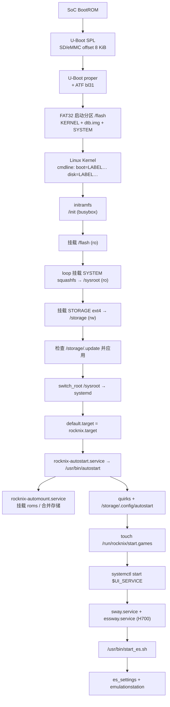
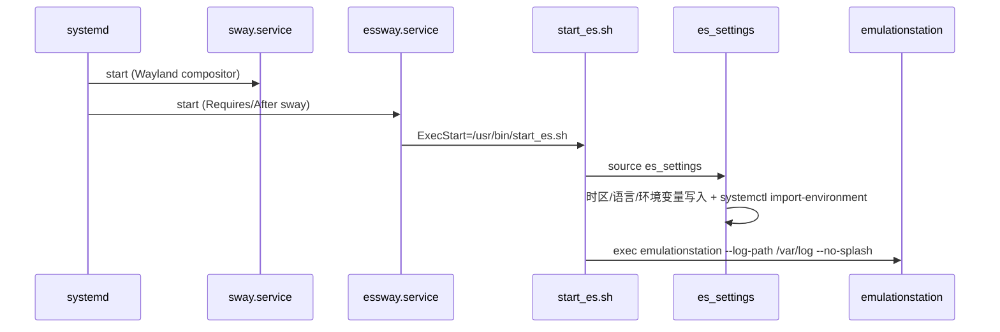

# 01 · 系统启动链路（H700 主线）

> 证据基线：本仓库 `next` 分支（`742bd52562`）。凡 `[事实]` 均附 `文件:行号`；`[推断]` 为多事实推导；`[待验证]` 需真机确认。

## 1. 总览



## 2. 各阶段与证据

### 2.1 Bootloader

| 项 | 事实 | 证据 |
|---|---|---|
| Bootloader 类型 | U-Boot（mainline sunxi） | `projects/ROCKNIX/devices/H700/options:34` `BOOTLOADER="u-boot"` |
| 固件组成 | U-Boot + ARM Trusted Firmware（bl31） | 同上 `UBOOT_FIRMWARE+=" atf"`、`ATF_PLATFORM="sun50i_h616"` |
| 写入位置 | 磁盘偏移 8 KiB（`seek=8`，1K 块） | `projects/Allwinner/bootloader/mkimage:6-7`；`projects/ROCKNIX/devices/H700/bootloader/update.sh:44-45` |
| DDR 变体 | DDR3 / DDR4 两份 U-Boot，按 `vdd-dram` 电压选择 | `projects/ROCKNIX/devices/H700/bootloader/update.sh:34-52` |
| 构建版本 | U-Boot `v2026.01` | 构建目录 `build.ROCKNIX-H700.aarch64/build/u-boot-DDR3-v2026.01/` |

`[事实]` U-Boot 配置启用 `CONFIG_DISTRO_DEFAULTS=y`、`CONFIG_BOOTCOMMAND="run distro_bootcmd"`、`CONFIG_BOOTMETH_EXTLINUX=y`（`build.ROCKNIX-H700.aarch64/build/u-boot-DDR3-v2026.01/.config:425-492`）。

`[待验证]` H700 镜像的 FAT32 启动分区内没有在仓库中找到 `extlinux/extlinux.conf` 模板；U-Boot 究竟通过 extlinux、`boot.scr` 还是内置 `bootcmd` 载入 `/KERNEL`，需要在真机 U-Boot 控制台或 `/proc/cmdline` 上确认。仓库中只有 RK3326 的 extlinux 模板（`projects/ROCKNIX/devices/RK3326/packages/u-boot/config/extlinux/extlinux.conf`）。

### 2.2 Kernel

| 项 | 事实 | 证据 |
|---|---|---|
| 内核镜像名 | `KERNEL`（`KERNEL_TARGET="Image"`） | `projects/ROCKNIX/devices/H700/options:25`；`scripts/mkimage:234` |
| 设备树 | `/flash/dtb.img` + `/flash/device_trees/*.dtb` + `overlays/` | `projects/ROCKNIX/devices/H700/bootloader/update.sh:24-32` |
| cmdline 关键参数 | `boot=LABEL=<BOOTLABEL> disk=LABEL=<DISKLABEL>` | `scripts/mkimage:153`（syslinux 分支）；Allwinner 由 U-Boot 传入同类参数 |
| 调试参数 | `quiet console=ttyS0,115200 console=tty0 systemd.debug_shell=ttyS0` | `projects/ROCKNIX/devices/H700/options:31` |
| 内核补丁 | H700 设备树、显示、电源、手柄等大量补丁 | `projects/ROCKNIX/devices/H700/patches/linux/` |

`[事实]` 内核模块与固件不是直接铺在 rootfs，而是通过 `kernel-overlays` 机制：`/usr/lib/modules` 与 `/usr/lib/firmware` 都是指向 `/run/kernel-overlays/...` 的软链（`scripts/image:220-223`）。

### 2.3 initramfs

`[事实]` 启动由 busybox init 脚本承担，主序列为（`projects/ROCKNIX/packages/sysutils/busybox/scripts/init:1294-1314`）：

```
load_modules → recovery_mode → check_disks → mount_flash → set_consolefont
→ cleanup_flash → update_bootmenu → mount_sysroot → mount_storage
→ load_splash → check_update → prepare_sysroot
```

| 步骤 | 行为 | 证据 |
|---|---|---|
| `mount_flash` | 以 `ro` 挂载 FAT32 启动分区到 `/flash` | `init:706` |
| `mount_sysroot` | 将 `/flash/SYSTEM` 以 loop、`ro` 挂到 `/sysroot` | `init:281-288` |
| `mount_storage` | 挂载 ext4 STORAGE 到 `/storage` | `init:732` |
| `check_update` | 若 `/storage/.update` 存在，校验并写入 Kernel/System/Bootloader | `init:1125-1128`、`init:393-441` |
| `prepare_sysroot` | 准备 `/sysroot` 下的运行时目录 | `init` 内 |
| 切换根 | `switch_root /sysroot /usr/lib/systemd/systemd` | `init:1372` |

`[事实]` SYSTEM 是 squashfs 只读镜像，由 `mksquashfs` 生成（`scripts/image:246`），压缩算法由 `SQUASHFS_COMPRESSION` 控制。

### 2.4 systemd

| 项 | 事实 | 证据 |
|---|---|---|
| 默认 target | `rocknix.target`（`Alias=default.target`） | `projects/ROCKNIX/packages/rocknix/system.d/rocknix.target:1-11` |
| target 依赖 | `Requires=multi-user.target graphical.target`，`After=graphical.target` | 同上 |
| 首次配置 | `userconfig.service`（`sysinit.target`）把 `/usr/config/*` 复制到 `/storage/.config` | `.../systemd/system.d/userconfig.service`、`.../systemd/scripts/userconfig-setup:12-21` |
| 自动挂载 | `rocknix-automount.service` → `/usr/bin/automount` | `projects/ROCKNIX/packages/rocknix/system.d/rocknix-automount.service` |
| 启动编排 | `rocknix-autostart.service` → `/usr/bin/autostart` | `projects/ROCKNIX/packages/sysutils/autostart/system.d/rocknix-autostart.service` |

### 2.5 UI 服务选择

`[事实]` `/usr/bin/autostart` 在完成 quirks、automount、`/usr/lib/autostart/common/*`、设备脚本与 `/storage/.config/autostart/*` 后：

```sh
rm /run/rocknix/start.games
touch /run/rocknix/start.games
systemctl start ${UI_SERVICE}
```
（`projects/ROCKNIX/packages/sysutils/autostart/sources/autostart:87-91`）

`[事实]` `UI_SERVICE` 由平台 quirk 写入 `/storage/.config/profile.d/090-ui_service`：

- H700：`UI_SERVICE="sway.service essway.service"`（`projects/ROCKNIX/packages/hardware/quirks/platforms/H700/090-ui_service`）
- 也有设备走 Weston + `emustation.service`（`projects/ROCKNIX/packages/ui/emulationstation/system.d/emustation.service`）

### 2.6 EmulationStation 的启动



证据：

- `essway.service`：`Requires=sway.service`、`After=sway.service`、`ExecStart=/usr/bin/start_es.sh`（`projects/ROCKNIX/packages/ui/emulationstation/system.d/essway.service`）
- `start_es.sh`：source `es_settings` → `prerotate_env` → `scanout_reset_stale` → 启动前端（`.../sources/start_es.sh`）
- `es_settings`：设置 `TIMEZONE`、locale、导入 quirk 变量（`.../sources/es_settings:10-57`）
- Weston 路径：`emustation.service` 直接 `ExecStart=/usr/bin/emulationstation`，并有 `ConditionPathExists=/run/rocknix/start.games`（`.../system.d/emustation.service`）

`[fork]` 本 fork 在 `start_es.sh` 中增加了 `handheld-launcher` 分支：若 `/usr/bin/handheld-launcher` 存在则 `exec` 它，否则回退到 `emulationstation`（`.../sources/start_es.sh:18-22`）。这属于本 fork 的改动，不属于上游 ROCKNIX 默认链路。

## 3. 关键结论

1. `[事实]` ROCKNIX 是 **双分区 + 只读 squashfs** 的“固件式”发行版：FAT32 启动分区放 KERNEL/SYSTEM/dtb，ext4 STORAGE 放全部可变数据。
2. `[事实]` 启动编排不是“systemd 直接拉起 ES”，而是 `rocknix.target → rocknix-autostart → /usr/bin/autostart → $UI_SERVICE → start_es.sh`。
3. `[事实]` UI 是可替换的 systemd 服务（`UI_SERVICE` 变量 + quirk 文件），ES 只是其中一个实现；H700 默认还叠加了 Sway 合成器。
4. `[推断]` 由于 ES 由 `essway.service` 以 `Restart=always` 拉起，杀掉 ES 进程会被 systemd 重新拉起；真正的“退出到桌面/关机”必须走 `run`/`powerstate` 等控制脚本，而不是简单退出进程。
5. `[待验证]` U-Boot 到 `/KERNEL` 的具体引导配置文件未在仓库中出现，需要在真机确认（见 2.1）。

## 4. 未决问题

- H700 的 U-Boot 环境变量与引导配置（`extlinux.conf` / `boot.scr` / 内置 bootcmd）具体是哪一种。
- `prepare_sysroot` 对 `/etc`、`/var` 做了哪些 tmpfs/软链处理（下一份文档继续追踪）。
- 首次启动 `fs-resize.service` 如何扩展 STORAGE 分区（见 02 文档）。
