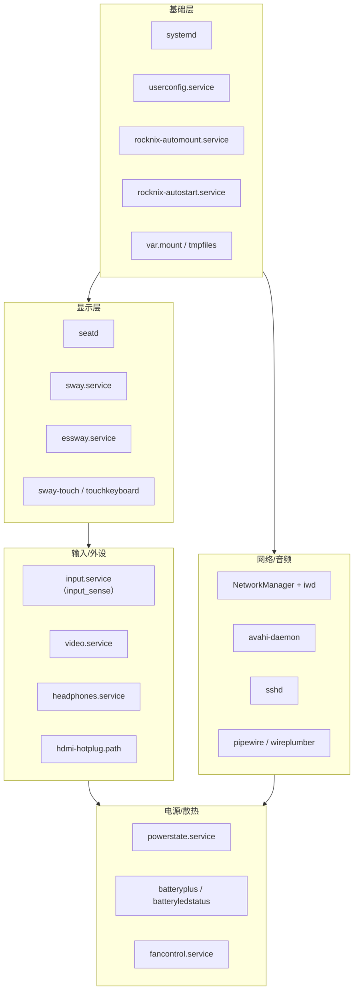

# 09 · 系统服务

> 基线：`next` @ `742bd52562`。服务清单来自 `projects/ROCKNIX/packages/**/system.d/*.service` 与各 `package.mk` 的 `enable_service`；是否在 H700 默认启用取决于 options 与元包依赖。

## 1. 服务分层

## 2. 关键服务清单

### 2.1 启动与配置

| 服务 | 作用 | 证据 |
|---|---|---|
| `userconfig.service` | 首次启动把 `/usr/config` 复制到 `/storage/.config`，建立 ES 配置软链 | `.../systemd/system.d/userconfig.service`、`userconfig-setup` |
| `rocknix-automount.service` | 挂载/合并 ROM 存储（internal/external） | `.../rocknix/system.d/rocknix-automount.service` |
| `rocknix-autostart.service` | quirks → automount → autostart 脚本 → 启动 `$UI_SERVICE` | `.../autostart/system.d/rocknix-autostart.service` |
| `machine-id.service` | 生成 systemd machine-id | `.../systemd/system.d/machine-id.service` |
| `save-sysconfig.service` | 关机前备份系统配置 | `.../rocknix/system.d/save-sysconfig.service` |
| `var.mount` | `/var` 挂 tmpfs | `packages/sysutils/busybox/system.d/var.mount` |
| `fs-resize.service` | 首次启动扩展 STORAGE 分区 | `.../busybox/system.d/fs-resize.service` |

### 2.2 显示与 UI

| 服务 | 作用 | 证据 |
|---|---|---|
| `seatd.service` | Wayland seat 管理（非 root 图形会话） | `packages/wayland/lib/seatd/system.d/seatd.service` |
| `sway.service` | Wayland 合成器（H700 默认 `swaywm-env`） | `projects/ROCKNIX/packages/wayland/compositor/sway/system.d/sway.service` |
| `essway.service` | 在 Sway 内启动 `start_es.sh` | `.../ui/emulationstation/system.d/essway.service` |
| `emustation.service` | Weston 路径下直接启动 ES | `.../ui/emulationstation/system.d/emustation.service` |
| `sway-touch.service` | 触摸屏相关配置 | `.../sway/system.d/sway-touch.service` |
| `touchkeyboard.service` | 触摸键盘 | `.../apps/rocknix-touchscreen-keyboard/system.d/touchkeyboard.service` |

### 2.3 输入与外设

| 服务 | 作用 | 证据 |
|---|---|---|
| `input.service` | `input_sense`：电源键/音量键/合盖事件 | `.../system-utils/system.d/input.service` |
| `video.service` | `video_sense`：视频输出/分辨率感知 | `.../system-utils/system.d/video.service` |
| `headphones.service` | 耳机插拔检测（切换音频路由） | `.../system-utils/system.d/headphones.service` |
| `hdmi-hotplug.path` | HDMI 热插拔触发 | `.../system-utils/system.d/hdmi-hotplug.path` |
| `sixaxis@.service` | PS3 手柄配对 | `packages/network/sixaxis/system.d/sixaxis@.service` |
| `inputplumber.service` | 部分设备（RK3566/SM8xxx）的手柄抽象层 | `projects/ROCKNIX/packages/tools/inputplumber` |

### 2.4 电源、电池、散热

| 服务 | 作用 | 证据 |
|---|---|---|
| `powerstate.service` | 根据 AC/电池切换性能策略 | `.../sysutils/powerstate/system.d/powerstate.service` |
| `batteryplus.service` | 基于电压的电量估算（H700 `BATTERYPLUS_SUPPORT=yes`） | `.../system-utils/system.d/batteryplus.service`、`H700/options:49` |
| `batteryledstatus.service` | 电池 LED | `.../system-utils/system.d/batteryledstatus.service` |
| `led-poweroff.service` | 关机 LED 状态 | `.../rocknix/system.d/led-poweroff.service` |
| `fancontrol.service` | 风扇曲线 | `.../system-utils/system.d/fancontrol.service` |
| `rtc-offset.service` / `rtc-offset-sync.path` | RTC 时区偏移同步 | `.../rocknix/system.d/rtc-offset*.service` |

### 2.5 网络与音频

| 服务/包 | 作用 | 证据 |
|---|---|---|
| `NetworkManager` + `iwd` | Wi-Fi/有线网络管理 | `projects/ROCKNIX/packages/virtual/network/package.mk:10` |
| `network-base.service` | 基础网络配置（hostname 等） | `.../systemd/system.d/network-base.service` |
| `systemd-resolved` / `systemd-timesyncd` | DNS / NTP | `enable_service` 列表 |
| `avahi-daemon` | mDNS（`.local` 发现） | `distributions/ROCKNIX/options:75` |
| `sshd.service` | SSH 远程登录 | `packages/network/openssh/system.d/sshd.service` |
| `tailscale` | 组网（包，非默认服务） | `virtual/network/package.mk:10` |
| `pipewire` / `wireplumber` | 音频服务（`PIPEWIRE_SUPPORT=yes`） | `distributions/ROCKNIX/options:41`、`enable_service` 列表 |
| `pulseaudio` | 备选音频（Weston/旧路径） | `packages/audio/pulseaudio/system.d/pulseaudio.service` |

### 2.6 存储、性能与维护

| 服务 | 作用 | 证据 |
|---|---|---|
| `rocknix-automount` | ROM 存储挂载/overlay 合并 | 见 2.1 |
| `storage-log.service` | 在 `/storage/.cache/log` 建持久日志目录 | `.../busybox/system.d/storage-log.service` |
| `rocknix-memory-manager.service` | 设置内存管理参数（`--setup`） | `.../rocknix/system.d/rocknix-memory-manager.service` |
| `systemd-oomd` | 内存压力时杀进程 | `enable_service systemd-oomd.service` |
| `entware.service` | `/opt` → `/storage/.opt`，opkg 生态 | `virtual/image/package.mk` 末尾、`entware.service` |
| `adbd.service` | Android ADB 调试（**本 fork 新增**） | `projects/ROCKNIX/packages/utils/adbd/system.d/adbd.service`、`H700/options:72` |

## 3. 核心 / 可裁剪分类

### A 类：核心（删除会导致系统无法正常启动或不可用）

| 组件 | 理由 |
|---|---|
| systemd、busybox init、kernel、squashfs 挂载 | 启动链必需（01 文档） |
| `userconfig` + `rocknix-automount` + `rocknix-autostart` | 首次配置、ROM 挂载、UI 启动编排 |
| `sway` + `seatd`（或 Weston 等价物）+ `essway` | H700 的显示与 UI 入口 |
| `input.service`（`input_sense`） | 电源/音量键；缺失会导致无法用按键关机/调音量 |
| `powerstate` + `batteryplus` | 电源/电量策略；缺失会影响续航与电量显示 |
| `NetworkManager` + `iwd` | Wi-Fi；掌机主要联网方式 |
| `pipewire`/`wireplumber`（或 pulseaudio） | 音频输出 |
| `rocknix-memory-manager` + `systemd-oomd` | 低内存设备的稳定性 |

### B 类：可替换（有替代实现）

| 组件 | 可替代为 | 依据 |
|---|---|---|
| EmulationStation | 任意实现 `es_systems` + `runemu.sh` 契约的前端 | 04 文档 |
| Sway | Weston（仓库已有 `emustation.service` + weston 路径） | `H700/options:55`、`emustation.service` |
| NetworkManager | connman（仓库保留 connman 单元） | `packages/network/connman/system.d/` |
| pipewire | pulseaudio | 两套单元都在仓库 |
| `input_sense` | 自写 evdev 守护进程 | 其行为是读 evdev + 执行动作 |
| `rocknix-autostart` | 自写启动编排 | 只是顺序执行脚本 |
| `rocknix-update` | 自建 OTA 客户端 | 10 文档 |
| `gptokeyb`/`inputfilter` | 自写按键映射层 | 仅独立模拟器使用 |

### C 类：可删除（不影响核心功能）

| 组件 | 说明 |
|---|---|
| `adbd` | 调试用；本 fork 新增，可关 |
| `entware` | 可选 opkg 生态 |
| `samba` / `nmbd` / `smbd` | 文件共享（默认 `SAMBA_SUPPORT=no`） |
| `syncthing` / `rclone` | 同步工具（`PKG_SYNC`，非核心） |
| `tailscale` / `zerotier` / `wireguard` | VPN/组网 |
| `docker`（`CONTAINER_SUPPORT`） | 容器支持，默认关闭 |
| `cron` | 定时任务，可选 |
| `simple-http-server` | 可选调试服务 |
| `kodi` | 媒体中心（ES 构建已 `DISABLE_KODI=1`，但包仍在树中） |
| 未使用的模拟器/核心 | 见 11 文档 |
| 额外主题 artwork 变体 | 已在构建时删除（07 文档） |

## 4. 结论

1. `[事实]` 服务的“核心”不是按包名划分，而是按启动链依赖：`rocknix.target → autostart → UI_SERVICE` 这条链上的任何一环缺失都会导致黑屏/无 UI。
2. `[事实]` 网络/音频/电源都有两套实现（NetworkManager/connman、pipewire/pulseaudio、sway/weston），说明发行版保留了替换空间。
3. `[推断]` 裁剪时应优先删除 C 类（无启动依赖），再评估 B 类替换；A 类只做“替换”不做“删除”。
4. `[待验证]` H700 默认实际启用的服务集合需要真机 `systemctl list-unit-files --state=enabled` 确认；本报告依据的是构建脚本的 `enable_service` 与 options。
