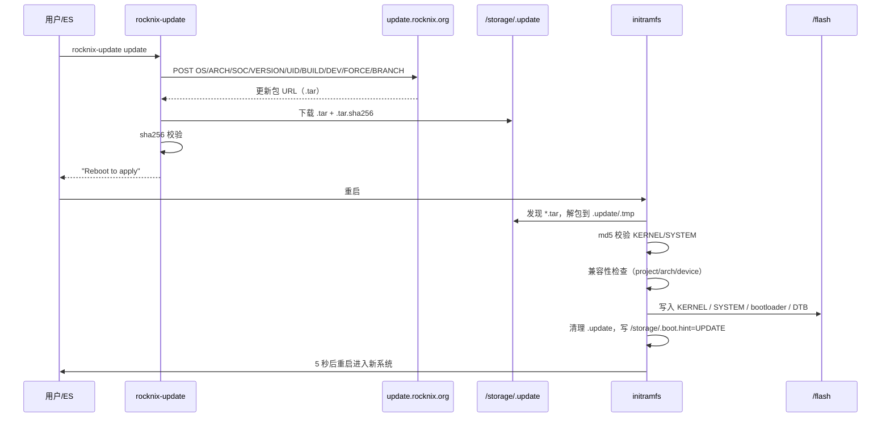

# 10 · OTA 升级

> 基线：`next` @ `742bd52562`。涉及两个组件：用户态 `rocknix-update`（下载/校验）与 initramfs `check_update`（应用/回写）。

## 1. 流程总览



## 2. 更新检查

`[事实]` `rocknix-update` 向固定端点 `https://update.rocknix.org` 发 POST，字段：

| 字段 | 含义 |
|---|---|
| `OS` / `ARCH` / `SOC` | 系统名、架构、SoC |
| `VERSION` / `BUILD` | 当前版本与构建号 |
| `UID` | `/storage/.cache/systemd-machine-id` 后 12 位 |
| `DEV` | `QUIRK_DEVICE`（设备 quirk 名） |
| `FORCE` | 强制版本（`updates.force`） |
| `BRANCH` | 更新通道（`updates.branch`） |

证据：`projects/ROCKNIX/packages/rocknix/sources/scripts/rocknix-update:9-30`。

`[事实]` 子命令：

```sh
rocknix-update check      # 打印可用版本号
rocknix-update update     # 下载并校验
rocknix-update releases   # 列出可用版本
rocknix-update 20250101   # 强制指定版本
```
（`rocknix-update:158-196`）

## 3. 下载与校验

`[事实]`：

1. 要求 `/storage` 至少 2 GB 空闲（`rocknix-update:82-86`）
2. 下载 `<url>` 到 `/storage/.update/<filename>`，同时下载 `<url>.sha256`（`:88-112`）
3. `sha256sum` 比对；失败则删除文件并退出（`:118-128`）
4. 成功后 `set_setting updates.force 0`、`sync`，提示重启（`:124-126`）

`[事实]` 更新包格式是 `.tar`（不是整盘 `.img.gz`）；`rocknix-update:99` 用 `basename` 保留原文件名，扩展名来自服务器返回的 URL。

## 4. 应用（initramfs）

`[事实]` 启动时 `check_update` 阶段（`init:871-1135`）：

1. 在 `/storage/.update` 找第一个 `*.tar`
2. 解包到 `/storage/.update/.tmp`
3. 用包内 `KERNEL.md5`、`SYSTEM.md5` 做 md5 校验（`:1031-1060`）
4. 兼容性检查：比较当前 `/sysroot` 与 `/update` 的 `PROJECT/ARCH/DEVICE`；不匹配时若包内有 `canupdate.sh` 则调用它裁决（`:319-376`）
5. 检查 FAT 分区剩余空间是否足够（`:1100-1117`）
6. 写入：
   - `KERNEL` → `/flash/KERNEL`（或块设备）
   - `SYSTEM` → `/flash/SYSTEM`
   - `update_bootloader`：调用包内 `/usr/share/bootloader/update.sh`（H700 会更新 U-Boot、DTB、overlays）
7. 写 `/storage/.boot.hint` 为 `UPDATE`，`sync`，5 秒后重启（`:1125-1135`）

`[事实]` 逃生开关（不推荐）：

- `/storage/.update/.nocheck`：跳过 md5 校验
- `/storage/.update/.nocompat`：跳过兼容性检查

（`init:1031`、`:1074`）

## 5. 回滚与分区策略

| 项 | 事实 | 证据 |
|---|---|---|
| 分区策略 | 单 SYSTEM 分区，**无 A/B 双系统** | `scripts/mkimage:71-86`（仅两个分区） |
| 回滚机制 | 无自动回滚；失败需重新刷写整盘镜像 | 无 A/B 槽位；`init` 无回滚分支 |
| 用户数据 | `/storage` 不参与更新，完整保留 | 见 02 文档 |
| 更新后清理 | `do_cleanup` 删除 `.update` 内容 | `init:824-858` |
| 启动标记 | `/storage/.boot.hint` 写 `UPDATE` | `init:1130` |

`[推断]` 因为 SYSTEM 是整文件覆盖，更新过程中断电会导致 SYSTEM 损坏且无法启动；这是“无 A/B”设计的直接代价。仓库没有提供 rescue 分区或双槽回退。

## 6. 更新通道

`[事实]` 通道由 `updates.branch` 设置决定，随 POST 的 `BRANCH` 字段传给服务器（`rocknix-update:9-30`）；`FORCE` 支持强制指定版本（`:158-170`）。

`[推断]` 自建发行版若要复用 OTA，需要同时替换：端点 URL、POST 字段契约、返回的 `.tar` 结构（`KERNEL`、`SYSTEM`、`*.md5`、`usr/share/bootloader/update.sh`）。

## 7. 结论

1. `[事实]` OTA 是“下载 tar → 重启 → initramfs 覆盖 SYSTEM/KERNEL”的两段式，不是运行时热更新。
2. `[事实]` 没有 A/B 分区，也没有自动回滚；可靠性依赖 md5/兼容性检查与不断电。
3. `[事实]` 用户数据与更新完全解耦，更新不会清除 ROM/存档/配置。
4. `[推断]` 对自建发行版而言，OTA 是最值得重新设计的部分（分区策略、签名、回滚），但本报告不做设计。
