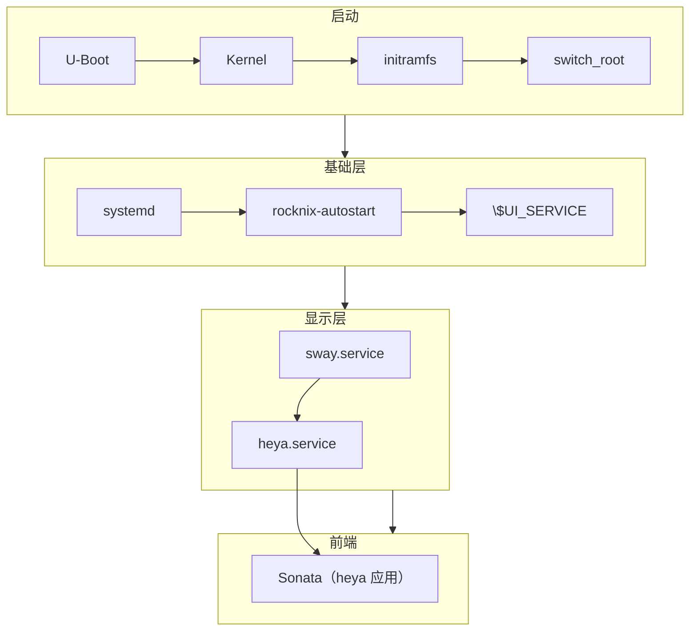

# 08 · 最小化报告

> 基线：`next` @ `742bd52562`。首个目标：H700 Pocket Linux 镜像。当前改动裁剪 H700 镜像，不影响其它设备。

## 1. 当前系统结构图

## 2. 建议保留组件

| 组件 | 理由 |
|---|---|
| U-Boot | 唯一启动入口 |
| Kernel + DTB | 系统基础 |
| GPU Driver + DRM/KMS | 显示 |
| Wayland + Sway | heya 的 compositor |
| SDL2 + SDL2_ttf | heya UI 库 |
| ALSA + PipeWire | 音频 |
| BlueZ | 蓝牙 |
| Wi-Fi (NetworkManager/iwd) | 网络 |
| SSH (openssh) | 远程管理 |
| systemd | 系统初始化 |
| heya | 新启动器 |
| Sonata + mpv | 音乐库与播放 |

## 3. 建议删除组件

| 组件 | 分类 |
|---|---|
| EmulationStation 与相关服务/配置 | H700 镜像不安装 |
| handheld-launcher | H700 镜像不安装 |
| ES 主题、scraper、成就和游戏集合 | H700 镜像不安装 |
| RetroArch、libretro 核心、独立模拟器 | H700 迷你镜像不打包 |
| ES 专属 scraper、成就和主题 | H700 迷你镜像不打包 |
| sway-touch / touchkeyboard | C 类风险未知 |
| video.service / headphones.service | C 类风险未知 |
| fancontrol.service | C 类风险未知 |

## 4. 风险分析

| 风险 | 等级 | 缓解 |
|---|---|---|
| 前端切换后启动链断裂 | 高 | H700 UI_SERVICE 启动 sway + heya |
| Sonata 首次启动没有应用条目 | 中 | autostart 将包内默认 manifest 复制到 `/storage/heya/apps` |
| 触摸/键盘输入 | 中 | 保留 sway-touch 或改用 heya 输入 |
| 电源/散热 | 低 | 保留 powerstate / fancontrol |
| 用户数据丢失 | 低 | `/storage` 不变，ES 配置可忽略 |
| 编译失败 | 中 | 分阶段验证，先编译再删 |

## 5. 迁移步骤

1. 创建 `heya-core-minimal` 分支并完成架构审计（已完成）
2. H700 包集合禁用游戏镜像、ES、旧 handheld-launcher 和可选服务（已实现）
3. 将 H700 UI_SERVICE 切换为 Sway + heya，并加入 Sonata 应用（已实现）
4. `make H700` 构建与设备启动验证（待执行）

## 6. 预计收益

| 项 | 估算 |
|---|---|
| 镜像体积、构建时间 | 待完整构建后测量 |
| 内存占用、启动时间 | 待设备测量 |
| 维护复杂度 | 由 H700 与其它设备共享少量包集合判断 |

## 7. 未验证项

- `[待验证]` H700 的 U-Boot 具体引导配置文件
- `[待验证]` `setsettings.sh` 的逐项 feature→RetroArch 选项映射
- `[待验证]` H700 默认启用的 systemd 服务全集
- `[待验证]` 完整构建耗时与各包体积
- `[待验证]` H700 镜像能否完整构建
- `[待验证]` 实机启动后 heya.service、Sonata 和 mpv 是否正常
