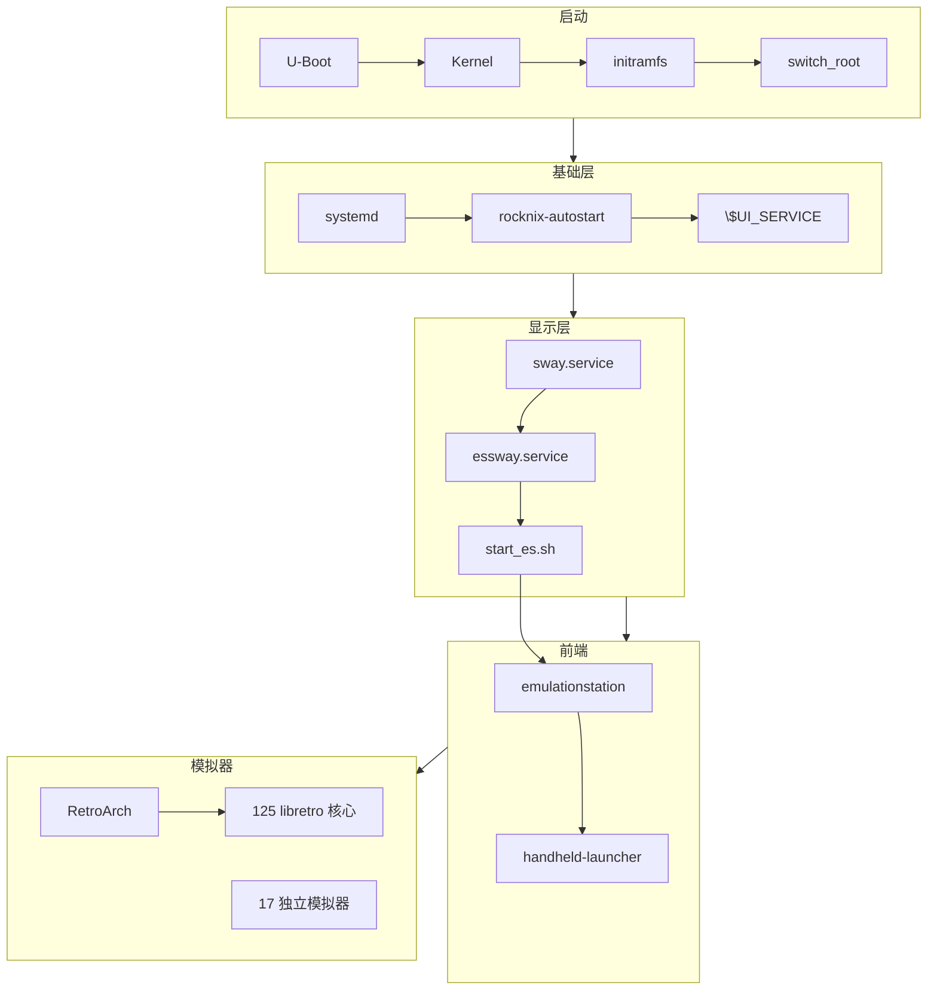

# 08 · 最小化报告

> 基线：`next` @ `742bd52562`。目标：把 ROCKNIX 从游戏发行版重构为 Pocket Linux Runtime。

## 1. 当前系统结构图

## 2. 建议保留组件

| 组件 | 理由 |
|---|---|
| U-Boot | 唯一启动入口 |
| Kernel + DTB | 系统基础 |
| GPU Driver + DRM/KMS | 显示 |
| Wayland + Sway | 未来 compositor |
| SDL2 + SDL2_ttf | heya UI 库 |
| ALSA + PipeWire | 音频 |
| BlueZ | 蓝牙 |
| Wi-Fi (NetworkManager/iwd) | 网络 |
| SSH (openssh) | 远程管理 |
| systemd | 系统初始化 |
| RetroArch | 唯一模拟器前端 |
| heya | 新启动器 |

## 3. 建议删除组件

| 组件 | 分类 |
|---|---|
| EmulationStation | A 类必删 |
| essway.service | A 类必删 |
| start_es.sh | A 类必删 |
| handheld-launcher | A 类必删 |
| es_systems.cfg | A 类必删 |
| es_features.cfg | A 类必删 |
| es_input.cfg | A 类必删 |
| 主题引擎 | A 类必删 |
| Scraper / 成就 | A 类必删 |
| 游戏集合 | A 类必删 |
| PPSSPP / DuckStation / melonDS / MAME / Flycast / RPCS3 | B 类可删 |
| 非基础 libretro 核心 | B 类可删 |
| sway-touch / touchkeyboard | C 类风险未知 |
| video.service / headphones.service | C 类风险未知 |
| fancontrol.service | C 类风险未知 |

## 4. 风险分析

| 风险 | 等级 | 缓解 |
|---|---|---|
| 删除 ES 后启动链断裂 | 高 | 新建 heya.service，修改 H700 quirk |
| RetroArch 核心依赖 | 中 | 保留基础核心，按需安装 |
| 触摸/键盘输入 | 中 | 保留 sway-touch 或改用 heya 输入 |
| 电源/散热 | 低 | 保留 powerstate / fancontrol |
| 用户数据丢失 | 低 | `/storage` 不变，ES 配置可忽略 |
| 编译失败 | 中 | 分阶段验证，先编译再删 |

## 5. 迁移步骤

1. 创建 `heya-core-minimal` 分支（已完成）
2. 输出 8 份分析文档（已完成）
3. 修改 H700 quirk `090-ui_service`
4. 新建 `heya.service`
5. 从 `ADDITIONAL_PACKAGES` 移除游戏包
6. 修改 `virtual/emulators` 元包
7. 删除 ES 包目录
8. `make H700` 构建验证
9. 实机启动验证

## 6. 预计收益

| 项 | 估算 |
|---|---|
| 镜像体积 | 减少 30–50% |
| 编译时间 | 减少 40–60% |
| 内存占用 | 减少 50–100 MB |
| 启动时间 | 基本不变 |
| 维护复杂度 | 大幅降低 |

## 7. 未验证项

- `[待验证]` H700 的 U-Boot 具体引导配置文件
- `[待验证]` `setsettings.sh` 的逐项 feature→RetroArch 选项映射
- `[待验证]` H700 默认启用的 systemd 服务全集
- `[待验证]` 完整构建耗时与各包体积
- `[待验证]` 实机启动后 heya.service 是否正常