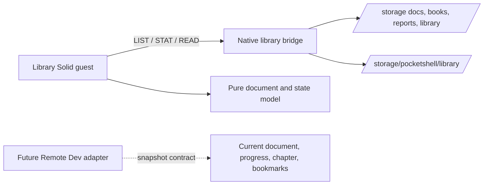
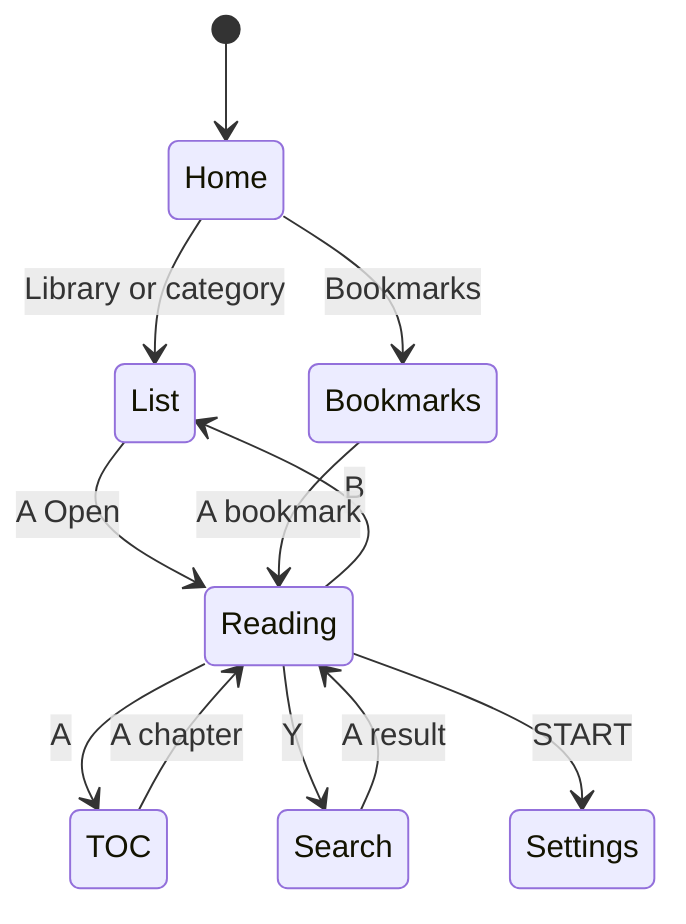

# PocketShell Library workspace

## Architecture



The Library guest uses PocketJS Solid, `TextField` for the system OSK, `onFrame` for verified button bitmasks, and the PocketJS `Text`/`View` components. Filesystem I/O stays behind the native `ui.__library(command)` bridge. `READ` seeks to an explicit byte offset and caps every transfer at 16 KiB. The browser harness supplies the same guest app with neutral fixture roots; it uses a temporary/in-memory state map and does not target production `/storage`.

## State files

All files are JSON UTF-8 beneath `/storage/pocketshell/library/`. `STATE_SET` writes a sibling temporary file and renames it into place; malformed JSON loads to an in-memory default and the original bytes are untouched.

- `progress.json`: array of `{ file, chapter, line, percentage, updatedAt }`.
- `bookmarks.json`: array of `{ file, chapter, line, timestamp, title }`.
- `history.json`: array of `{ file, title, lastRead, favorite }`.
- `settings.json`: `{ fontSize, lineHeight, margins, theme, showProgress }`; themes are `dark`, `light`, `amber`, `green`, `paper`.

The persistence directory is outside immutable `/usr`, SlotA/SlotB, package build/install roots, and OTA staging. A slot switch or rollback must leave `/storage/pocketshell/library/` mounted unchanged. This is a path ownership contract; the CPR #86 OTA workflow has not been exercised end to end here.

## Remote Dev snapshot contract

The additive snapshot shape is:

```json
{
  "version": 1,
  "current": { "file": "/storage/books/example.md", "chapter": 2, "line": 42, "percentage": 18.4, "bookmarks": [] },
  "progress": 18.4,
  "chapter": 2,
  "bookmarks": [{ "file": "/storage/books/example.md", "chapter": 2, "line": 42, "timestamp": 0, "title": "Example" }]
}
```

`librarySnapshot` is the adapter boundary for a later Remote Dev merge. Local shape tests do not establish live CPR #85 protocol integration; that branch is isolated and has not been merged.

## Controller mapping

| Input | Library action |
|---|---|
| D-pad Up/Down | Move selection; one line in Reading |
| Left/Right | Small reading jump |
| L1/R1 | Previous/next 24-line page |
| L/R | Chapter jump; currently uses the corresponding small reading jump until section selection |
| A | Open/continue; TOC while reading |
| B | Back one view |
| X | Bookmark; hold opens bookmarks |
| Y | Search using PocketJS TextField/OSK; submit with Y |
| START | Settings; A cycles the selected setting |
| SELECT | Agent menu placeholder entries only |

## State machine



## Future only

EPUB and PDF readers, annotations, collections, and reading goals are reserved. There is no Linux Reader/less/glow subprocess path. Agent actions are labels only. No physical RG34XX acceptance or live OTA/Remote Dev integration is claimed.
