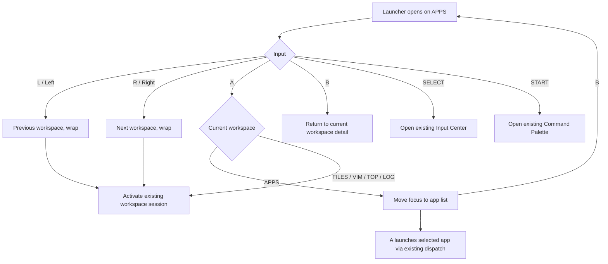

# PocketShell Launcher Workspace 重构设计

## 1. 布局草图（720×480）

逻辑 UI 为 360×240，显示像素按 2×呈现。顶部状态栏保持轻薄；工作区详情占据中段；底部只有图标导航。

```text
┌────────────────────────────────────────────────────────────────────────┐
│ 09:41   ● Wi-Fi   ───  78%                                      JAPANESE│  Status Bar
│                                                                        │
│                                                                        │
│       [workspace pixel mark]                                          │
│       Applications                                                    │  Detail
│       Launch tools, inspect and control this system.                   │
│       SYSTEM · 19 ITEMS                                                │
│                                                                        │
│                                                                        │
│                                                                        │
│                                                                        │
│        ◇       ◇       ◇       ◇       ◇                              │  Icon navigator
│       APPS    FILES    VIM     TOP     LOG                              │  marks only
│                                                                        │
│  L/R MOVE                                               A OPEN  B BACK │
└────────────────────────────────────────────────────────────────────────┘
```

导航器中的 ◇ 是统一点阵图标，每个工作区使用同一网格、线宽和像素密度规则；文字仅在工作区详情区显示一次。列表和设置条目使用同一套点阵 glyph，不引入独立图标库。实现时以实际可用 icon font glyph 映射代替草图符号。

## 2. 交互流程



Compatibility contract (from the current `hello/main.tsx` and `pocketshell-launcher.rs`):

- Five persistent sessions remain APPS, FILES, VIM, TOP, LOG; workspace switch calls existing `switchTo` and refreshes the matching session.
- L/R and Left/Right switch horizontally with wraparound. START advances in the launcher; A opens the selected item; B returns to the application detail. In a live workspace, A sends Enter, B sends Escape and returns to Launcher, SELECT opens Input Center, START advances workspace.
- Native apps continue through `LAUNCH`; tool entries continue through `heya-tool`, Gamepad Test through `evtest`, terminal remains the existing shell session.
- Existing settings actions retain their current `__launcher` commands. Language preference is added as an app setting with native persistent storage.

## 3. 焦点状态

| State | Focus owner | Visual treatment | Input behavior |
|---|---|---|---|
| Workspace overview | Bottom workspace navigator | Selected mark scales to 1.16× and uses mint accent; others lower contrast | L/R move selection; A activates; B stays/returns to detail; SELECT/START preserve their existing global actions |
| App list | Vertical list in APPS detail | One selected row uses accent glyph and underline; no nested card | Up/Down move; A launch; B returns to workspace overview |
| Settings list | Vertical settings list | Same pixel glyph and row focus treatment | Up/Down move; A apply/toggle; language cycles 日本語 → 中文 → English; B returns |
| Active workspace | Workspace session content | Navigator selection remains reflected in small active mark | Existing terminal and Input Center bindings remain unchanged |
| Input Center / Command Palette | Existing overlay/editor | Existing focused field remains authoritative | Existing SELECT and START semantics are preserved by routing before workspace navigation |

## 4. 动画说明

- Workspace selection: 120 ms ease-out scale from 1.0 to 1.16 and accent fade; unselected icons settle to 0.72 opacity.
- Detail transition: outgoing detail fades to 0 over 90 ms while translating 5 logical pixels opposite navigation; incoming detail fades to 1 over 130 ms from 5 pixels along navigation.
- Status bar and navigator stay fixed to preserve orientation. No continuous pulse or parallax; motion is input-driven and one transition at a time.
- At 60 Hz the transitions span roughly 6–8 frames. Without animation API support on a given host, state changes remain immediate and fully usable.

## 5. PocketJS 组件结构

```text
LauncherRoot (360×240 logical; scales to 720×480)
├── StatusBar
│   ├── Clock / connectivity / battery (available values only)
│   └── Language indicator
├── WorkspaceDetail (keyed by active workspace)
│   ├── Pixel workspace mark
│   ├── Localized name, description and type (single occurrence)
│   └── APPS-only AppList | SettingsList
├── WorkspaceNavigator
│   └── PixelIcon × 5 (icon only; active/focus state)
└── Existing overlays
    ├── InputCenter
    └── CommandPalette
```

Components use PocketJS Solid `View`, `Text`, and `Index`; animation uses the pinned runtime's supported native style/tween facilities. The five workspace data records carry localized name/description/type and one pixel glyph identifier. Launcher preference persistence uses a narrowly scoped `__launcher` preference command backed by `/storage/pocketshell/launcher/settings.json`; it does not alter Library state.

## 6. 重构计划

1. Preserve and document the current navigation/session/launch contract; inspect the pinned runtime component and button APIs.
2. Add native launcher preference read/write for the language field and default to Japanese when unset; persist atomically under the PocketShell launcher state directory.
3. Add compact Japanese, Simplified Chinese, and English message/workspace catalogs, and route every Launcher-visible string through the selected locale.
4. Replace only the launcher presentation with status/detail/icon navigator; retain app launch, settings action, terminal, Input Center, and Command Palette dispatch.
5. Add a consistent point-grid glyph map for workspace and list/navigation symbols using bundled pixel font support.
6. Compile and run the real PocketJS bundle using the pinned official host; inspect 720×480 output and a 1280×720 browser preview. Exercise key transitions, wraparound, launch/settings actions, locale changes, and persistence restart.

## 7. 旧版与新版对照

| Area | Old launcher | New launcher |
|---|---|---|
| Information layout | Text list under Applications/Settings header; workspace name in a separate terminal header | Thin status bar, one central workspace detail, icon-only bottom navigator |
| Workspace choice | Left/right key changes sessions but launcher content remains application list | L/R smoothly changes the selected workspace detail; five icon marks remain visible |
| Repeated labels | Workspace context and launcher page are separate; list rows repeat labels as text | Name, description, type appear once in detail; no navigator captions |
| Visual language | Rectangular selected row and generic text glyphs | Open composition, restrained focus scale, unified pixel glyph system |
| Available screen | 360×240 logical canvas mostly occupied by 8 visible rows | 720×480 panel allocated to status, generous detail area, navigator, and control hint |
| Language | English launcher strings plus hard-coded Chinese control hints | Japanese default; Japanese, Chinese, English catalogs with persistent setting |
| Existing functions | App launch, settings actions, five sessions, Input Center and Command Palette | Same dispatch and key semantics, exposed through redesigned overview/detail states |
