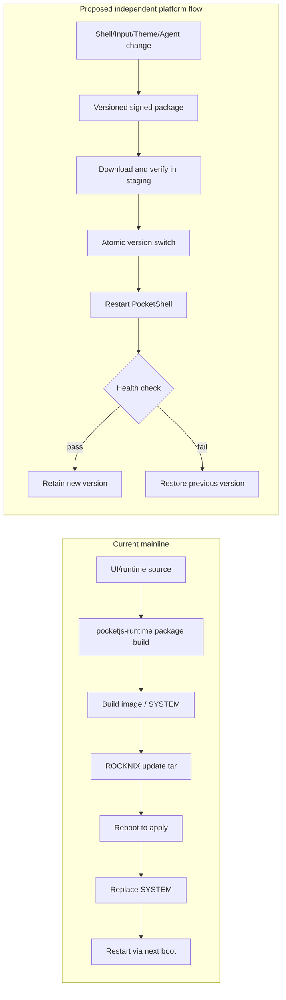

# CPR #89 — PocketShell Platform Architecture Audit

> Scope: source audit and migration design at main `4bb749cb304cc515f13b800e7fb3299cdefc3e6d`. No runtime/package behavior changed. Paths and line references below describe that baseline. Claims about hardware are explicitly marked unverified.

Companion artifacts: [Migration roadmap](migration-roadmap.md), [current architecture diagram](architecture.mmd), and [current/target update flow](update-flow.mmd).

## 1. Verdict

**Platform Not Ready.** Applying the requested deployment criterion—change Shell/Input/Library/Theme/Agent, create an independently versioned package, deliver it through OTA, restart PocketShell without rebuilding ROCKNIX `SYSTEM` or a full image—fails at each deployment seam.

`pocketjs-runtime` copies `hello/` and `config/` into a host build and compiles `boot.pocket` ([package.mk](../../projects/ROCKNIX/packages/apps/pocketjs-runtime/package.mk#L15-L27)); target build patches and compiles the PocketJS Rust runtime ([package.mk](../../projects/ROCKNIX/packages/apps/pocketjs-runtime/package.mk#L35-L44)). Its install puts the runtime, launch scripts, app, profile and systemd units into `${INSTALL}/usr` ([package.mk](../../projects/ROCKNIX/packages/apps/pocketjs-runtime/package.mk#L47-L67)). The H700 options include this package in the image package set ([options](../../projects/ROCKNIX/devices/H700/options#L91-L92)). A package-only build exists ([Makefile](../../Makefile#L107-L108)) and can incrementally rebuild a package ([build](../../scripts/build#L43-L53)), but build-plan logic says non-image builds build packages without installing them ([genbuildplan.py](../../scripts/genbuildplan.py#L203-L214)). The release image path assembles the root filesystem, emits SquashFS and copies it as `target/SYSTEM` ([image](../../scripts/image#L128-L137), [image](../../scripts/image#L245-L249), [image](../../scripts/image#L292-L300)).

ROCKNIX OTA downloads a tar, asks for reboot, then initramfs validates and writes `KERNEL` and `SYSTEM` to `/flash` (`projects/ROCKNIX/packages/rocknix/sources/scripts/rocknix-update:88-129`; `projects/ROCKNIX/packages/sysutils/busybox/scripts/init:921-938,1032-1070,1122-1137`). It has no PocketShell component package/install/restart path in this baseline. Thus changed UI requires rebuilding `pocketjs-runtime`; updating the device through documented OTA requires a SYSTEM-bearing update and reboot. This does not imply every update needs recompiling every source package: the build stamp skips unchanged package work, and `make package` is separate. It does mean an updated package must be incorporated into a new SYSTEM through image generation for the observed deployment route.

`/storage/.config/pocketjs/runtime.conf` is a service environment file, while the service executes `/usr/libexec/pocketjs-session` and that script defaults to `/usr/share/pocketjs/apps/boot.pocket` with runtime `/usr/libexec/pocket-linux-kms` (`system.d/pocketjs-kms.service:12-19`; `scripts/pocketjs-session:4-7`). Persistent configuration does not make executable platform components independently deployable.

## 2. Directory tree and deployment mapping

Classification: **image-baked** = installed into image `${INSTALL}`; **persistent** = writable `/storage`; **generated** = build output; **absent** = no independent platform component found in this mainline scope.

| Component | Source / destination | Current classification and evidence |
|---|---|---|
| PocketJS native runtime | Upstream pinned source, patched by `scripts/patch-runtime.py`, installed `/usr/libexec/pocket-linux-kms` | Image-baked. Build at `package.mk:35-49`; target install. |
| PocketShell PTY manager and ANSI/screen model | `scripts/pocketshell-terminal.rs`, copied into pinned runtime by `patch-runtime.py` | Image-baked inside native runtime; not a separately versioned library (`patch-runtime.py:12-15,35-82`; `package.mk:40-44`). |
| `boot.pocket` guest app | `hello/` + `config/`, compiled to `generated/boot.pocket`, installed `/usr/share/pocketjs/apps/boot.pocket` | Source image-baked; compiled app generated at build time (`package.mk:15-27,47-57`). |
| Workspaces and UI | `hello/main.tsx` | Image-baked within `boot.pocket`; workspace UI and keyboard are one app (`hello/main.tsx:7-10,36-49,219-286`). |
| Themes and visual assets | UI source/styles, `hello/fonts.json`, `hello/fonts/` and package-generated profile | Image-baked with app/profile; no independent installed theme package or external theme root identified in this package. `package.mk:15-27,54-57`. |
| Scripts and launch configuration | `scripts/pocket`, `pocketjs-session`, `pocket-session-run`, native launcher; `/storage/.config/pocketjs/runtime.conf` | Scripts image-baked under `/usr/bin` and `/usr/libexec` (`package.mk:50-53`); optional runtime environment config persistent (`system.d/pocketjs-kms.service:12-19`). |
| systemd / rootfs | `system.d/*.service`, installed `/usr/lib/systemd/system`; binaries and assets under `/usr` | Image-baked (`package.mk:59-67`). H700 options select the package (`devices/H700/options:91-92`). |
| PocketJS user data directories | `/storage/pocketjs/apps`, `data`, `cache`, `logs` | Persistent directories created at session start (`scripts/pocketjs-session:7`). Their existence does not relocate the packaged runtime/app. |
| Independent PocketShell package manifest/update unit | No platform-owned package/update metadata found in audited mainline paths | Absent. Existing packaging is the ROCKNIX package recipe plus whole-system OTA described above. |

## 3. Dependency and build matrix

The named feature terms are evaluated as requested capabilities, not asserted as existing independent modules. A source edit under `hello/` currently flows through the same `pocketjs-runtime` recipe.

| Change | Source area (mainline evidence) | Package target | SYSTEM/image under current release route? | Device update / restart currently |
|---|---|---|---|---|
| Workspace shell UI | `hello/main.tsx` | `pocketjs-runtime` host app compile + target package (`package.mk:15-27,47-57`) | Yes to include on device: image generation packages into SYSTEM (`scripts/image:133-137,245-249`). | OTA requires reboot and writes SYSTEM; service has systemd restart policy on process failure, no component OTA (`rocknix-update:123-125`; init `1122-1137`; unit `20-22`). |
| Input Workspace / input UX | `hello/main.tsx` input tabs and handlers (`:36-49,112-153,255-286`) | `pocketjs-runtime` | Same | Same |
| Theme | UI styles and profile in `hello/`, `config/profile.ts`; package generated profile (`package.mk:21-27,54-57`) | `pocketjs-runtime` | Same | Same |
| Assets/fonts | `hello/fonts.json`, `hello/fonts/`, guest app asset imports | `pocketjs-runtime` | Same | Same |
| Agent UI | `hello/main.tsx` contains an `Agent` input tab and prompt strings only (`hello/main.tsx:37,46-48`); no independent Agent workspace/backend evidenced | `pocketjs-runtime` for the current UI | Same | UI changes follow the same build/update path; backend code would have a separate dependency/package requirement if introduced. |
| Library Workspace | No independent library workspace module found in the audited package; README lists possible future native PocketJS apps as design (`hello/README.md:87-94`) | If implemented in current guest app: `pocketjs-runtime`; independent package not present | Same | Same |
| Command Palette | No separately packaged palette identified; current command prompt UI is in `hello/main.tsx:30-31,140-147,242-245` | `pocketjs-runtime` | Same | Same |
| Host PTY/ANSI/parser changes | `scripts/pocketshell-terminal.rs`, injected by `scripts/patch-runtime.py` | `pocketjs-runtime` target build | Yes | Same |

A package-only build can reduce build scope and reuse stamps, but the checked build plan expressly does not install packages for non-image builds (`scripts/genbuildplan.py:208-214`). No source evidence found for shipping the resulting package directly to an installed device.

## 4. Runtime independence

| Runtime part | Current owner | Independent version/deployment? |
|---|---|---|
| PTY manager | `PocketShell` in `scripts/pocketshell-terminal.rs`, owns PTY sessions (`:859-884,945-1003`) | No. Compiled into the PocketJS native runtime by runtime patch/build (`patch-runtime.py:12-15`; `package.mk:40-44`). |
| ANSI parser and terminal model | Same Rust module; PTY bytes become parser/screen/dirty rows (module header and `hello/README.md:8-17`) | No separate ABI or package. |
| Renderer | Guest `hello/main.tsx`; renders terminal runs and cursor (`:219-254`) | No; compiled into `boot.pocket`, installed by same package. |
| Remote Dev | No remote-development workspace implementation found in this mainline audit. Active separate feature branch existence is not capability evidence. | Absent from mainline baseline; no package/version/update claim. |

The crate/package boundary couples host runtime changes and guest UI delivery even though host and guest have a logical interface. Establishing a stable host ABI and independent guest app package is a migration goal, not a current property.

## 5. ROCKNIX / rootfs coupling

| Coupling | Severity | Evidence and effect |
|---|---|---|
| `/usr` executable and share paths | High | Runtime, session helpers and boot app are installed to `/usr/libexec`, `/usr/bin`, `/usr/share` (`package.mk:47-57`); startup hardcodes those paths (`scripts/pocketjs-session:4-7`). |
| systemd service lifecycle | High | Unit runs on tty7, uses `/usr/bin/chvt`, restarts service, and is wanted by `rocknix.target` (`system.d/pocketjs-kms.service:10-26`). |
| ROCKNIX package recipe | High | One recipe builds and installs host runtime, guest app, support scripts and units (`package.mk:15-67`). H700 opts into it (`devices/H700/options:91-92`). |
| Rootfs/SYSTEM image build | High | Image path creates rootfs, installs image packages, emits SquashFS and release `target/SYSTEM` (`scripts/image:128-137,245-249,292-300`). |
| OTA contract | High | Update client downloads distro tar and asks reboot (`rocknix-update:88-129`); initramfs validates and replaces kernel/system, then reboots (`init:1032-1070,1122-1137`). No app-level hot update contract. |
| `/storage` app/data directories | Medium | Session creates persistent PocketJS directories (`pocketjs-session:7`); they can hold user data/apps but default executable remains `/usr/share/.../boot.pocket` (`:4-6`). |
| `/storage/.config` runtime config | Medium | Unit optionally imports user config (`pocketjs-kms.service:12-13`), but this config only supplies environment. |
| DRM/KMS and tty device access | High | Service config binds tty7 (`pocketjs-kms.service:14-19`); runtime is explicitly Linux DRM/KMS (`package.mk:11`). Actual board-specific operation is not validated by source audit. |
| `/etc` | Low / not direct app coupling observed | This package installs no files under `/etc`; systemd unit and ROCKNIX target still depend on OS-managed service configuration. |

## 6. Mainline history and worktrees

The audit worktree base and `origin/main` were both verified as `4bb749cb304cc515f13b800e7fb3299cdefc3e6d` (`Add PocketShell input workspace`, 2026-10-28). The required worktree is `/home/tetsuya/development/.worktrees/pocketshell-platform`, branch `feature/platform-separation`.

At inspection, separate worktrees existed for `feat/pocketshell-remote-dev` (HEAD `1ba3adb1201def7da153f3d1de1aa1630488861d`), `feat/pocketshell-ota-ab` (`0d3d69153e7f5f824c4489c708ed7426c29ef83f`), `feature/library-workspace` (base SHA), and `feature/pocketjs-showcase` (base SHA). These are isolated branch/worktree facts only. Their code is not included in this verdict or mainline capability claims.

## 7. Risk register

| Severity | Risk and impact | Source evidence | Mitigation direction |
|---|---|---|---|
| Critical | Routine UI/theme changes require building and deploying the ROCKNIX runtime package through SYSTEM OTA; updates require device reboot. | `package.mk:15-27,47-67`; `scripts/image:245-249,292-300`; init `1122-1137` | Separate platform runtime and signed app/package update channels with explicit compatibility metadata. |
| High | Runtime patching ties PocketShell host code to the pinned upstream runtime internals; upstream changes can break patch assumptions. | `package.mk:3,40-44`; `scripts/patch-runtime.py:12-82` | Upstream stable extension ABI or maintained, versioned host integration boundary. |
| High | UI and native PTY/ANSI runtime share one package version/release unit; rollback granularity is the ROCKNIX system. | `package.mk:35-57`; `pocketshell-terminal.rs:871-903` | Independent runtime and guest app versions, compatibility checks, rollback slots. |
| High | Service startup assumes systemd, tty7, `/usr` layout and DRM device availability; user config cannot replace these executable dependencies. | `system.d/pocketjs-kms.service:10-26`; `pocketjs-session:4-7` | Small host service bootstrap with validated platform paths/capabilities and safe console recovery. |
| High | Existing OTA writes `SYSTEM` in place and reboots; no per-app update, A/B PocketShell slot or app-level rollback evidence. | `rocknix-update:88-129`; init `1122-1137` | Signed atomic staging, previous-version retention, health-check rollback and update-independent data. |
| Medium | User data and downloaded apps share a persistent `/storage` tree while executable default is image-owned; migration may overwrite or orphan user state if boundaries are unclear. | `pocketjs-session:4-7` | Versioned data schema, immutable platform code and explicit user data migration. |
| Medium | Agent/Library/Palette labels can be mistaken for shipped standalone modules; mainline source only proves guest app UI portions and future workspace design. | `hello/main.tsx:37,46-48`; `hello/README.md:87-94` | Maintain a capability inventory tied to mainline source and mark branch-only work clearly. |
| Medium | Hardware behavior is not established by host source/build descriptions. | `hello/README.md:66-73` explicitly says no RG34XX display/button/boot test | Hardware acceptance on supported device revisions after deployment design. |

## 8. Migration roadmap (design only)

1. **Define the platform contract.** Specify process lifecycle, display/input capabilities, stable host ABI, workspace/app manifest, resource lookup, logging, version negotiation and failure codes. Keep distro-specific integrations behind the platform bootstrap.
2. **Choose writable code root and preserve user data.** Prefer `/storage/pocketshell` for atomic updates if ROCKNIX writable storage semantics are required, or `/opt/pocketshell` only if the OS provides an independently writable/preserved mount. Separate `platform/`, `apps/`, `themes/`, `cache/`, `logs/`, and durable user data. Never overwrite user workspace data during code update.
3. **Split version units.** Platform native runtime (PTY/ANSI/input/render host), Shell app, Input app, Library app, Theme/assets, Agent app/backend each get manifests and compatibility constraints. Keep a minimal image-baked bootstrap and recovery console only.
4. **Bootstrap service.** Keep the systemd unit small and image-baked; it launches the selected platform from writable root, validates it, then starts the last-known-good version on failure. Config should select versions/paths without containing executable code.
5. **Safe package transaction.** Download signed package metadata and artifacts to a staging directory, verify signature/hash/platform ABI, unpack to a versioned directory, fsync, atomically switch a current pointer, restart PocketShell, perform a health check, then retain previous version until success. On failure restore pointer and restart previous version.
6. **OTA integration.** Add a distinct component channel and client/service that does not feed PocketShell-only packages to initramfs' kernel/SYSTEM updater. Preserve the existing ROCKNIX OTA for OS/kernel/bootloader changes. Provide explicit device compatibility, authentication, sequencing and offline recovery.
7. **Roll out in compatibility layers.** First ship bootstrap + runtime in SYSTEM; next enable signed runtime package updates; then independently update Shell/Input; finally themes/assets and optional Library/Agent modules. Measure update size and recovery success before removing image-baked fallback.

No steps above are implemented by this audit.

## 9. Route to 90% development without SYSTEM/image builds

A realistic target is that **90% of iterative UI/product changes** avoid SYSTEM/image generation after the platform update mechanism exists. This is a proposed engineering mix, not a measured current statistic.

| Work type | Target share of iteration | Required route |
|---|---:|---|
| Browser/harness-only UI, workspace navigation, theme/layout, fake input/device state | 55% | Standalone browser harness that uses the same guest UI modules and mock host ABI. Current `hello/browser-preview.html` is explicitly demo data and does not prove parity (`:18-29`). |
| Package-only compile/validation | 25% | Compile `boot.pocket` and run guest/ABI checks without image assembly; current `make package` can build but does not install image packages (`Makefile:107-108`; `genbuildplan.py:208-214`). |
| Runtime-only native changes | 10% | Build/test PTY manager, ANSI parser, renderer bridge against a stable host ABI; current code is compiled into `pocketjs-runtime` (`package.mk:40-49`). |
| SYSTEM/rootfs changes | 8% | Bootstrap/service integration, system libraries, rootfs permissions/configuration changes still need a SYSTEM-bearing release. |
| Firmware/kernel/DTB/boot changes | 2% | Hardware enablement, kernel drivers, boot chain; requires device-specific firmware/image path and hardware verification. |

This route reaches the 90% target as a roadmap allocation (55+25+10), not a claim about present workflows. Present-day package builds are useful for fast feedback but no standalone OTA/install/restart route was found. Percentages should be recalibrated from actual change history after the harness and package updater exist.

## 10. Diagrams

### Current architecture

```mermaid
flowchart TB
  subgraph Source[Mainline source]
    UI[hello/main.tsx\nShell and input UI]
    CFG[config/profile.ts\nPocketJS profile]
    PTY[scripts/pocketshell-terminal.rs\nPTY + ANSI + screen model]
    PATCH[scripts/patch-runtime.py]
    RECIPE[package.mk]
  end
  UI -->|Bun compiles| APP[generated boot.pocket]
  CFG -->|profile export| PROFILE[generated profile]
  PTY --> PATCH --> RUNTIME[PocketJS native runtime]
  APP --> RECIPE
  PROFILE --> RECIPE
  RUNTIME --> RECIPE
  RECIPE -->|makeinstall_target| ROOTFS[/usr/libexec + /usr/share + systemd]
  SERVICE[pocketjs-kms.service] --> SESSION[pocketjs-session]
  SESSION --> RUNTIME
  SESSION --> APP
  STORAGE[/storage config and user data] -. environment/user state .-> SERVICE
  ROOTFS --> SYSTEM[ROCKNIX SYSTEM image]
  SYSTEM --> OTA[ROCKNIX tar OTA]
  OTA -->|reboot + replace SYSTEM| DEVICE[Device]
```

### Current and target update flow



Target diagram is a design, not existing capability.

## Evidence notes

- All file line references target the verified mainline baseline SHA above.
- `make package` semantics, package stamps, build-plan installation behavior, image generation and OTA file replacement were inspected in source. No actual package/image/OTA build was run.
- No hardware behavior was verified. The guest README explicitly says RG34XX display, button and boot testing has not run (`projects/ROCKNIX/packages/apps/pocketjs-runtime/hello/README.md:66-73`).
- Mainline active feature worktrees were not merged or treated as capabilities.

## 11. Migration roadmap

See [migration-roadmap.md](migration-roadmap.md) for the sequenced design. All recommendations there are proposed; this audit implements no platform behavior.
