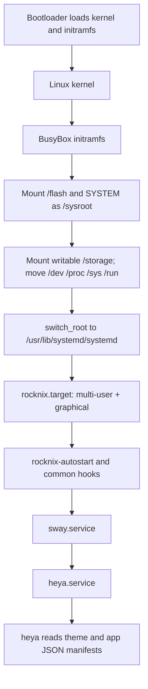

# ROCKNIX runtime audit

Repository references below describe the checked-in build configuration on `heya-core-minimal`. The existing generated H700 install tree is an ARM64 root (its `usr/bin/bash` is AArch64), but lacks installed heya, xmplayer, RetroArch, and `heya.service`; it is not evidence of a complete bootable runtime. This build tree is local generated state, not a tracked release artifact.

## Build system and RootFS

- The project uses a package-based cross build. `Makefile` maps `H700` to `scripts/build_distro` for `arm` and `aarch64`; `AMD64` maps to `ARCH=x86_64` ([Makefile:37-40](Makefile#L37), [Makefile:71-74](Makefile#L71)). `scripts/build_distro` loads distro/device options and invokes `make image` for the normal architecture path ([scripts/build_distro:18-24](scripts/build_distro#L18), [scripts/build_distro:86-98](scripts/build_distro#L86)).
- `make image` runs `scripts/image mkimage` ([Makefile:11-12](Makefile#L11)). The virtual `image` package defines base system dependencies and conditionally adds UI, multimedia, sound, graphics, and emulator groups ([image/package.mk:11-28](projects/ROCKNIX/packages/virtual/image/package.mk#L11), [image/package.mk:35-72](projects/ROCKNIX/packages/virtual/image/package.mk#L35)). `scripts/build` resolves package target dependencies from `PKG_DEPENDS_TARGET` ([scripts/build:58-80](scripts/build#L58)).
- `scripts/image` removes/recreates `BUILD/image/system`, creates the base `/etc`, `/dev`, `/proc`, `/run`, `/sys`, `/tmp`, `/usr`, `/var`, `/flash`, `/storage` layout, then assembles packages and project/device filesystem overlays ([scripts/image:122-134](scripts/image#L122), [scripts/image:177-197](scripts/image#L177)). The result is SquashFS via `mksquashfs`; release packaging calls it `SYSTEM` and places it with `KERNEL` in a release tar ([scripts/image:244-253](scripts/image#L244), [scripts/image:255-315](scripts/image#L255)). The examined paths do not show a RootFS tar export; the extracted `BUILD/image/system` directory is the build-time tree suitable for container experiments.
- Image assembly also creates kernel module and firmware links and relies on the device kernel/bootloader, so a container using only `/usr` and libraries is a userspace approximation, not the entire booted device ([scripts/image:207-223](scripts/image#L207)).
- Package installation is collected under the configured build root's `image/system`; the existing generated H700 tree contains ARM64 base files without the requested applications. Its provenance is local generated state, not a tracked or independently verified release artifact.

## Filesystem layout and persistence

| Path | Provenance / purpose |
| --- | --- |
| `/etc`, `/usr` | RootFS directories; package install rules and project/device overlays populate the image ([scripts/image:128-131](scripts/image#L128), [scripts/image:177-197](scripts/image#L177)). |
| `/var` | RootFS directory, with systemd mount units used for runtime state ([scripts/image:128-131](scripts/image#L128)). |
| `/flash` | Boot partition mountpoint populated by initramfs from the boot device ([busybox init:706-716](projects/ROCKNIX/packages/sysutils/busybox/scripts/init#L706)). |
| `/storage` | Writable persistent storage partition in normal boot, or tmpfs in live/no-disk cases; initramfs creates mountpoint and mounts it ([busybox init:16-20](projects/ROCKNIX/packages/sysutils/busybox/scripts/init#L16), [busybox init:732-769](projects/ROCKNIX/packages/sysutils/busybox/scripts/init#L732)). Runtime tmpfiles creates common storage paths including ROMs ([rocknix-dirs.conf:5-9](projects/ROCKNIX/packages/rocknix/tmpfiles.d/rocknix-dirs.conf#L5)). heya manifests are copied from `/usr/share/heya/apps` to `/storage/heya/apps`, preserving existing user files ([050-heya-apps:8-34](projects/ROCKNIX/packages/apps/heya/autostart/050-heya-apps#L8)). |
| `/userdata` | No ROCKNIX creation or mount path was found in the inspected boot/filesystem code. xmplayer detects it as a compatibility path; that alone does not establish a ROCKNIX mount. |
| `/run`, `/tmp`, `/dev`, `/proc`, `/sys` | Initramfs creates mountpoints and mounts kernel/runtime filesystems; moves them to new root before `switch_root` ([busybox init:16-29](projects/ROCKNIX/packages/sysutils/busybox/scripts/init#L16), [busybox init:1331-1372](projects/ROCKNIX/packages/sysutils/busybox/scripts/init#L1331)). |

Image root ownership is normalized to root by the fakeroot image script ([scripts/image:116-126](scripts/image#L116)). Runtime-created directories and user data are distinct from this read-only system tree.

## Boot and application startup

The initramfs mounts `SYSTEM` read-only at `/sysroot`, mounts storage, verifies systemd, moves special filesystems and executes `switch_root` to systemd ([busybox init:281-291](projects/ROCKNIX/packages/sysutils/busybox/scripts/init#L281), [busybox init:1141-1154](projects/ROCKNIX/packages/sysutils/busybox/scripts/init#L1141), [busybox init:1331-1372](projects/ROCKNIX/packages/sysutils/busybox/scripts/init#L1331)). `rocknix.target` requires multi-user and graphical targets ([rocknix.target:1-9](projects/ROCKNIX/packages/rocknix/system.d/rocknix.target#L1)).

H700 sets the default `UI_SERVICE="sway.service heya.service"` ([H700 090-ui_service:6-9](projects/ROCKNIX/packages/hardware/quirks/platforms/H700/090-ui_service#L6)). `heya.service` requires and follows sway, conflicts with EmulationStation's sway service, and starts `/usr/bin/heya` with `/storage/heya` theme/apps arguments ([heya.service:1-22](projects/ROCKNIX/packages/apps/heya/integrations/rocknix/heya.service#L1)). The package installs that service and a boot seeder ([heya/package.mk:36-74](projects/ROCKNIX/packages/apps/heya/package.mk#L36)). `001-setup` creates runtime directories and is copied as a common autostart hook ([rocknix package.mk:71-83](projects/ROCKNIX/packages/rocknix/package.mk#L71), [001-setup:20-38](projects/ROCKNIX/packages/rocknix/autostart/001-setup#L20)).

## App discovery and launch

- **heya:** package installs `/usr/bin/heya`, settings/assets and built-in app manifests under `/usr/share/heya/apps`; boot seeding copies absent manifests into `/storage/heya/apps` ([heya/package.mk:36-69](projects/ROCKNIX/packages/apps/heya/package.mk#L36), [050-heya-apps:8-34](projects/ROCKNIX/packages/apps/heya/autostart/050-heya-apps#L8)). The service passes `/storage/heya/themes/theme.json` and `/storage/heya/apps` ([heya.service:9-15](projects/ROCKNIX/packages/apps/heya/integrations/rocknix/heya.service#L9)).
- **EmulationStation:** package installs `/usr/bin/emulationstation` and `/usr/bin/start_es.sh`. Startup loads settings, reads display mode and rotation, then executes `handheld-launcher` when present, otherwise EmulationStation ([emulationstation package.mk:61-75](projects/ROCKNIX/packages/ui/emulationstation/package.mk#L61), [start_es.sh:5-18](projects/ROCKNIX/packages/ui/emulationstation/sources/start_es.sh#L5)). H700 sets `EMULATION_DEVICE=no`; in that mode package generation writes a tools-only `es_systems.cfg` ([H700/options:71-88](projects/ROCKNIX/devices/H700/options#L71), [emulationstation package.mk:78-97](projects/ROCKNIX/packages/ui/emulationstation/package.mk#L78)).
- **RetroArch:** the virtual emulator package maps systems to emulator/core pairs and generates EmulationStation config; actual emulators/cores enter the graph only when emulation is enabled ([emulators/package.mk:138-178](projects/ROCKNIX/packages/virtual/emulators/package.mk#L138), [emulators/package.mk:1693-1718](projects/ROCKNIX/packages/virtual/emulators/package.mk#L1693), [image/package.mk:71-72](projects/ROCKNIX/packages/virtual/image/package.mk#L71)). RetroArch is not installed in the existing H700 tree.
- **xmplayer:** package installs the Love app, wrappers and heya manifest; wrapper sets ROCKNIX storage paths and library path before executing the bundled Love runtime ([xmplayer/package.mk:18-33](projects/ROCKNIX/packages/apps/xmplayer/package.mk#L18), [xmplayer wrapper:4-31](projects/ROCKNIX/packages/apps/xmplayer/scripts/xmplayer#L4)).

## Service dependencies

Direct heya dependencies are `rocknix.target` → graphical target → sway → heya. The configured `rocknix.target` requires `multi-user.target` and `graphical.target`; the heya unit itself directly requires and follows `sway.service`, and conflicts with `essway.service` ([rocknix.target:1-9](projects/ROCKNIX/packages/rocknix/system.d/rocknix.target#L1), [heya.service:1-22](projects/ROCKNIX/packages/apps/heya/integrations/rocknix/heya.service#L1)). Application manifests may launch additional apps, so their transitive needs depend on the app. The heya unit sets a runtime directory and Wayland/SDL environment; its package links SDL libraries ([heya.service:9-15](projects/ROCKNIX/packages/apps/heya/integrations/rocknix/heya.service#L9), [heya/package.mk:11-25](projects/ROCKNIX/packages/apps/heya/package.mk#L11)). The heya unit does not directly declare battery, Bluetooth, automount, or network service dependencies.

## Shared libraries and multimedia

- heya's target package depends on SDL2 and SDL2_ttf and sets CGO link flags `-lSDL2 -lSDL2_ttf` ([heya/package.mk:11-25](projects/ROCKNIX/packages/apps/heya/package.mk#L11)). The service also requires a compatible SDL video/audio backend and game controller database path ([heya.service:9-15](projects/ROCKNIX/packages/apps/heya/integrations/rocknix/heya.service#L9)).
- xmplayer is explicitly AArch64-only and declares mpv, SDL2, FreeType, OpenAL Soft, Ogg/Vorbis, mpg123 and zlib package dependencies ([xmplayer/package.mk:4-10](projects/ROCKNIX/packages/apps/xmplayer/package.mk#L4)). It bundles its Love runtime and `libs`, prepends those libraries to `LD_LIBRARY_PATH`, and expects mpv, ffmpeg, ffplay and gptokeyb in its runtime environment ([xmplayer wrapper:5-24](projects/ROCKNIX/packages/apps/xmplayer/scripts/xmplayer#L5)). Its playback implementation uses FFmpeg decoding for audio, and external mpv/ffplay for video ([ffmpeg_audio.lua:117-123](projects/ROCKNIX/packages/apps/xmplayer/app/media/ffmpeg_audio.lua#L117), [player.lua:75-125](projects/ROCKNIX/packages/apps/xmplayer/app/players/player.lua#L75)). This reports declared/runtime executable dependencies; exact ELF `.so` closure requires the built app artifacts and loader inspection, which are absent from the existing root.
- EmulationStation declares SDL2, SDL2_mixer, ALSA, VLC, DRM and other libraries, and enables PulseAudio at configure time ([emulationstation package.mk:10-24](projects/ROCKNIX/packages/ui/emulationstation/package.mk#L10)). The H700 mini image keeps multimedia selection to mpv and does not add the sound group from `image/package.mk` ([image/package.mk:25-43](projects/ROCKNIX/packages/virtual/image/package.mk#L25)). The H700 configuration names Panfrost, Wayland/Sway and no 32-bit compatibility stack ([H700/options:41-73](projects/ROCKNIX/devices/H700/options#L41)).

## Runtime environment and device assumptions

heya's unit exports `HOME=/storage`, `XDG_RUNTIME_DIR=/var/run/0-runtime-dir`, `WAYLAND_DISPLAY=wayland-1`, `SDL_VIDEODRIVER=wayland`, `SDL_AUDIODRIVER=pulseaudio` and `SDL_GAMECONTROLLERCONFIG_FILE=/usr/config/SDL-GameControllerDB/gamecontrollerdb.txt` ([heya.service:9-15](projects/ROCKNIX/packages/apps/heya/integrations/rocknix/heya.service#L9)). xmplayer exports `/storage`-based music/picture/video/config paths, `CFW_NAME=ROCKNIX`, a bundled `LD_LIBRARY_PATH`, and app `PATH` ([xmplayer wrapper:4-14](projects/ROCKNIX/packages/apps/xmplayer/scripts/xmplayer#L4)).

H700-specific assumptions include Cortex-A53/aarch64 target, Allwinner H700, U-Boot/ATF, Panfrost, Wayland/Sway, board kernel/device-tree modules, Batteryplus, 32-bit compatibility disabled, and a debug UART ([H700/options:5-18](projects/ROCKNIX/devices/H700/options#L5), [H700/options:21-55](projects/ROCKNIX/devices/H700/options#L21), [H700/options:68-90](projects/ROCKNIX/devices/H700/options#L68)). These hardware interfaces are not supplied by an ordinary desktop container.
