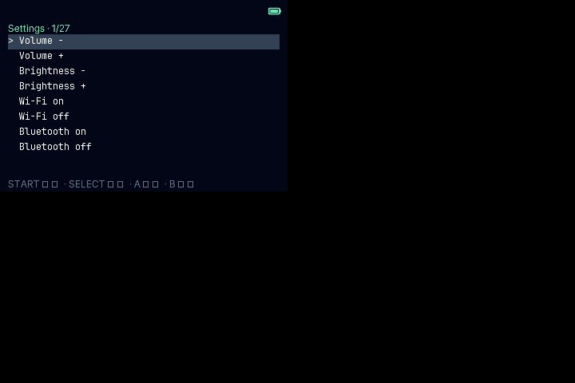
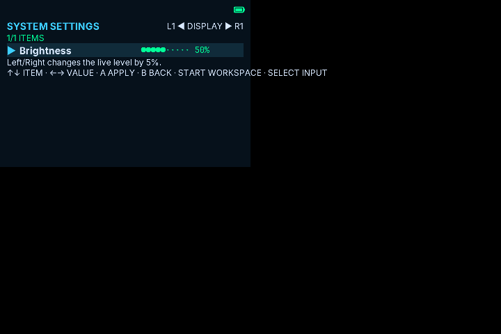
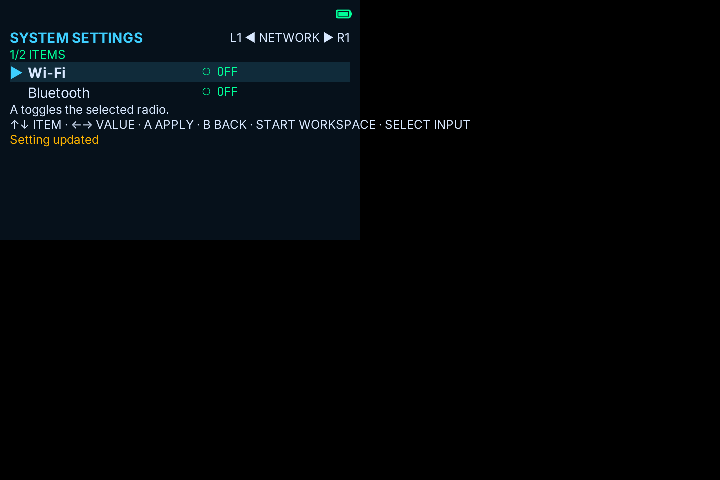
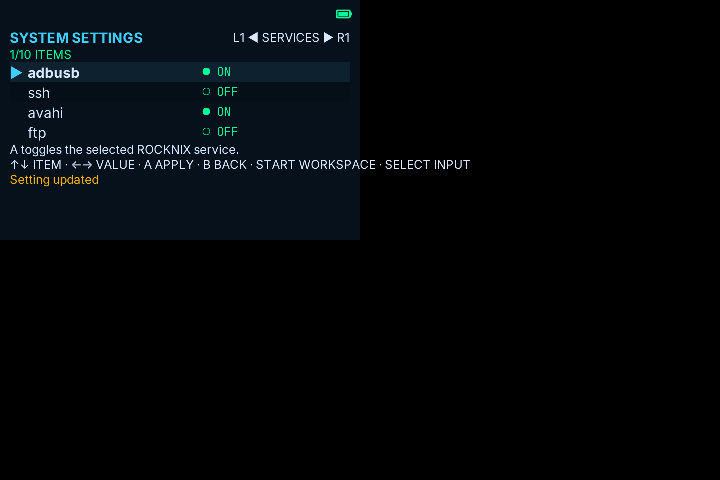
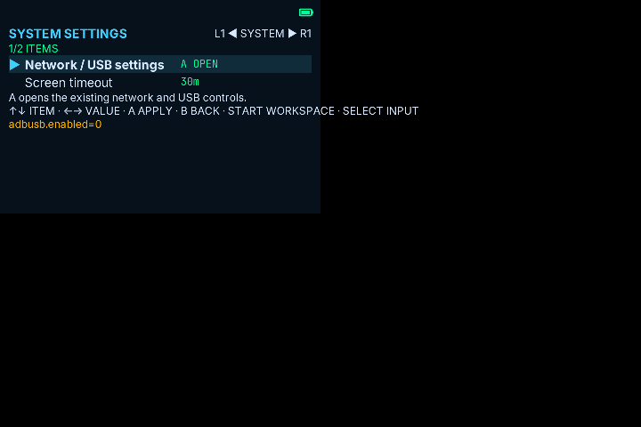

# PocketShell System Settings Workspace redesign

## Current state and problems

The current workspace lives inside `projects/ROCKNIX/packages/apps/pocketjs-runtime/hello/main.tsx`. It presents settings as a flat command list. Brightness and volume begin with hardcoded display values (80 and 50), even though activation separately queries live values through the launcher bridge. Wi-Fi and Bluetooth are separate on/off commands, and services are toggle commands without an in-list status. Screen timeout is represented as eight independent commands. Network/USB settings hand off to the existing legacy settings program. The layout has no Category → Setting → Value hierarchy or focused-item description.

The app runs in a 360×240 logical coordinate space rendered at 2× on the RG34XX, producing the 720×480 panel. Text-input ownership dispatches keyboard arrows, Enter, and Escape to the launcher. Controller dispatch currently uses UP/DOWN for selection, CIRCLE/Enter to activate, CROSS/Escape to return, LEFT/RIGHT to switch workspaces, START to advance workspace, LTRIGGER/RTRIGGER for terminal page scrolling, and SELECT for text input. `BTN.LTRIGGER`/`BTN.RTRIGGER` are the actual shoulder semantics available to the app; their display labels in the on-screen keyboard are L1/R1. In settings, shoulders can change category without affecting the app text terminal. Existing B/A/Start/Select meanings remain intact.

## Preserved settings and contracts

| Category | Existing item(s) | Existing operation and backing path | Preserved input and side effect |
|---|---|---|---|
| DISPLAY | Brightness | `STATE brightness` / `LEVEL brightness` reads the first usable `/sys/class/backlight/*/brightness` divided by `max_brightness`; `CONTROL brightness 0..100` calls `heya-control brightness <value>`. | Up/down selects; left/right immediately changes by 5 points, clamped to 5–100. |
| AUDIO | Volume | `STATE volume` / `LEVEL volume` reads `pactl get-sink-volume @DEFAULT_SINK@`, then `amixer get Master`; `CONTROL volume 0..100` calls `heya-control volume <value>`. | Up/down selects; left/right immediately changes by 5 points, clamped 0–100. |
| NETWORK | Wi-Fi | `STATE wifi` reads `wifi.enabled`; `CONTROL wifi on|off` calls `heya-control wifi <value>`. | A toggles the current saved radio state. Focus/category navigation has no radio side effect. |
| NETWORK | Bluetooth | `STATE bluetooth` reads `controllers.bluetooth.enabled` from `/storage/.config/system/configs/system.cfg`; `CONTROL bluetooth on|off` calls `heya-control bluetooth <value>`. | A toggles the current saved radio state. Focus/category navigation has no radio side effect. |
| SERVICES | adbusb, ssh, avahi, ftp, http, rsyncd, samba, syncthing, telnet, `pocket` + `shell-dev` | `STATE <key>` calls `rocknix-services status <key>.enabled`; `SERVICE <key>.enabled` calls `rocknix-services toggle`. | Up/down selects; A toggles the focused service only. The command result reports success/failure. |
| SYSTEM | Network / USB settings | Existing launcher entry runs `/usr/libexec/pocketjs-legacy-settings` via the current PTY. | A opens existing network scan/connect and USB gadget roles; B returns to launcher. |
| SYSTEM | Screen timeout | `SLEEP\tnever|10s|30s|1m|5m|15m|30m|1h` writes `[sleep] timeout` in `/storage/.config/pocketjs/runtime.conf`, then tries to restart `pocketjs-sleep.service`. | Left/right selects timeout; A/Enter persists the selected value and restarts the sleep daemon. The daemon dims the backlight after inactivity and restores it on input. |

No theme, remote development, ADB, or other new settings are added. Wi-Fi network selection and USB modes remain within the existing legacy utility rather than being duplicated.

### Live values and read limits

The native `STATE` bridge reads brightness and volume through the same `/sys/class/backlight`, `pactl`, and `amixer` sources used by `LEVEL`; Wi-Fi through `rocknix-settings --command load --key wifi.enabled`; Bluetooth through the persisted `controllers.bluetooth.enabled` value in `system.cfg`; each service through `rocknix-services status`; and timeout from `[sleep] timeout` in `runtime.conf` (with the sleep daemon's real 30m default when absent). Read failures remain `unknown`.

## Information architecture

SYSTEM SETTINGS                       L1 / R1 CATEGORY
DISPLAY
  ▶ Brightness      ●●●●●·····  50%    ← / → live, 5% steps
AUDIO
  Volume            ●●●●●●····  60%    ← / → live, 5% steps
NETWORK
  Wi-Fi             ● OFF
  Bluetooth         ● OFF
SERVICES
  ▶ adbusb          ● ON
    ssh             ○ OFF
    avahi           ● ON
    ... focused row window (4 visible of 10)
SYSTEM
  Network / USB settings              A open existing utility
  Screen timeout       30m → 5m        ← / → stage · A save

↑ / ↓ ITEM · A APPLY / OPEN · B BACK · START WORKSPACE · SELECT INPUT
```

Each category contains only existing settings. Category changes wrap across DISPLAY, AUDIO, NETWORK, SERVICES, SYSTEM. Selection wraps within a category. A visible current category, selected setting, and value communicate Category → Setting → Value. Details occupy one compact line only when the focused setting supplies a useful explanation.

## Visual and interaction rules

- Canvas: `#06111B`; primary text `#D8E8FF`; focus `#3ECFFF`; success `#00FF99`; warning or unavailable `#FFB400`.
- One-pixel separators only where needed; no per-row cards. Focus uses `▶` plus a clear text/value color change.
- Brightness and volume use ten-cell pixel bars and percentages. Network and service state labels use ON/OFF only when live state is backed by a read; otherwise `?` / `UNAVAILABLE` in warning color.
- Icons, if present, use a consistent 16×16 or 24×24 vector-pixel grid. Do not use Material/Android icons.
- Category transitions target 200 ms; focus changes target 150 ms. Keep motion limited to simple position/color changes, with no gradients, large cards, or glass effects.
- Preserve the app's 360×240 logical viewport so the native RG34XX display remains exactly 720×480. Browser preview scales the same UI to 1280×720.

## PocketJS component tree

```text
PocketShell root (hello/main.tsx)
└── Existing launcher workspace page
    └── SettingsWorkspace (hello/settings-workspace.tsx)
        ├── category/value header
        ├── four-row window (focused row marker and value)
        ├── focused-item detail line
        └── control and command-result lines
```

`settings-workspace.tsx` owns Settings content. `main.tsx` retains the existing workspace lifecycle, controller event wiring, and Launcher/Settings selection. The bridge in `scripts/pocketshell-launcher.rs` remains the only place that reads operating-system state or performs setting mutations. The component receives item data and display callbacks; it performs no I/O.

## Verification and evidence plan

HX90 isolated pinned-source commands and results:

- `bun tools/pocket.ts check --runtime-config programs/rocknix-h700/pocket.runtime-config.ts --target rocknix-h700-kms --manifest apps/rocknix-h700/pocket.json` — PASS, 61 TypeScript modules.
- `bun tools/pocket.ts compile ... --output apps/rocknix-h700/settings.pocket` — PASS; output bundle installed under `apps/rocknix-h700/dist/`.
- `bun tools/wasm.ts` — PASS; official `pocketjs.wasm` built.
- `POCKETJS_PROFILE_RS=../rocknix-h700/generated/pocket_profile.rs cargo build --locked --release -p pocket-linux-kms --target x86_64-unknown-linux-gnu` — PASS.
- `pocket-linux-kms --package apps/rocknix-h700/apps/rocknix-h700/settings.pocket --check` — PASS, admitted for `rocknix-h700-kms`.
- `pocket-linux-kms --package apps/rocknix-h700/apps/rocknix-h700/settings.pocket --headless --frames 300` — PASS, completed 300 ticks at 720×480.
The compiled bundle rendered through the official PocketJS WASM pixel renderer at 720×480. `before-flat-settings.png` was compiled from branch HEAD before the redesign; `after-display.png`, `after-network.png`, `after-services.png`, and `after-system.png` were captured from the final bundle. `preview-1280x720.html` was opened in isolated Chrome with CSS viewport exactly 1280×720; its 720×480 frame is displayed at 1080×720 (3× integer scale), centered without distortion. Chrome screenshot output is 1600×900 at device scale factor 1.25, stored as `preview-1280x720.png`.

The renderer bridge returned deterministic fixture values (initial brightness 50, volume 60, radio/service states and timeout). The values in PNGs are not physical RG34XX readings. The full controller interaction trace contains 726 `STATE` reads and 41 explicit writes: nine brightness steps to the 5% floor, twelve volume steps to 0%, both radio toggles, one toggle of each of the ten service rows, and all eight screen timeout saves. Focus/category navigation does not write a setting. `shell-handoff.txt` records opening the existing Network/USB utility path. Temporary interaction drivers executed the compiled bundle and did not run device commands.

The 1280×720 static browser visual preview was inspected; browser-side button interaction was not exercised. Physical RG34XX controls and its display were not available. Native KMS smoke used an x86_64 HX90 host; it passed package admission and 300 headless ticks at 720×480 but exposes no pixels. No permanent test files or format command were run.

## Before and after








The WASM frame values above come from a deterministic, local bridge fixture. Native state source paths and mutation semantics are documented separately; these screenshots do not claim real hardware reads or writes.
