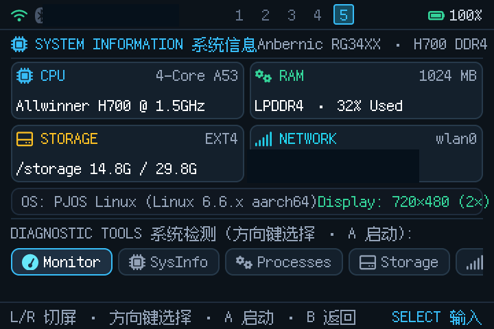
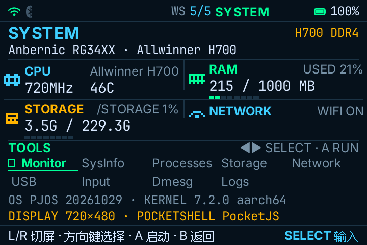
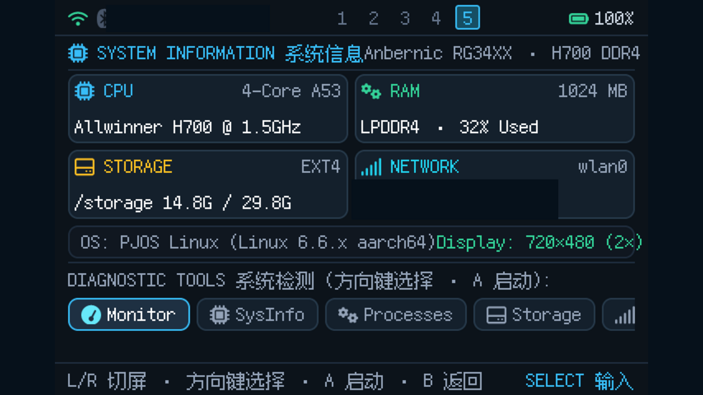
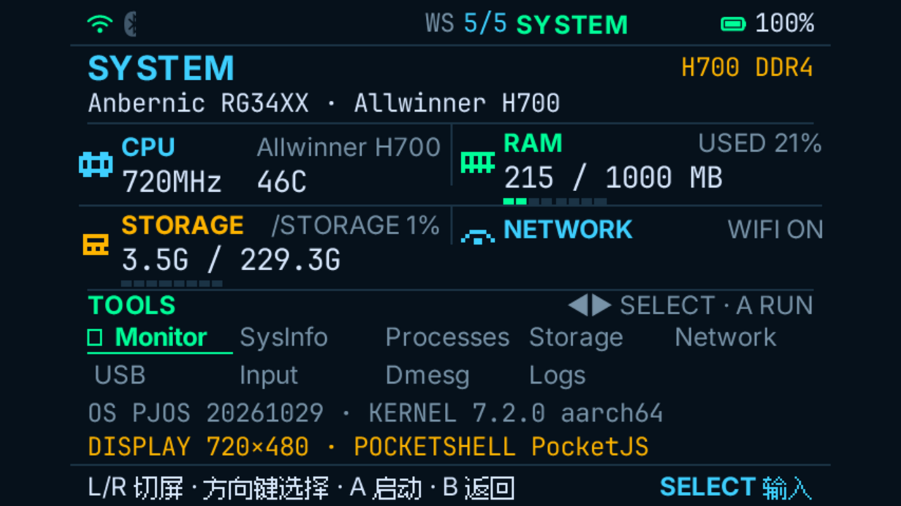

# PocketShell System Workspace redesign

## Baseline

`main` at `f7459a51bc` contains the five-screen PocketJS launcher. Screen 5 is the existing `pages/system-page.tsx`; the other four screens and all existing launcher behavior remain in place. The target is this existing System page, not a new route, workspace, launcher home, or standalone app.

The RG34XX runs the same five-screen UI at a 360×240 logical viewport with 2× rasterization on the 720×480 panel.

## Old presentation problems

The captured baseline is `screenshots/system-before-720x480.png`.

- CPU, RAM, storage and kernel values were hard-coded. CPU showed `4-Core A53 @ 1.5GHz`, RAM showed `LPDDR4 · 32% Used`, and storage showed `14.8G / 29.8G` rather than live system values.
- Each metric sat inside a rounded card, producing a card wall with nested borders.
- The title and identity text collided with the first grid row. OS/display text overflowed the right edge.
- The five-screen indicator showed only numbered dots; the current workspace name was absent.
- Tool selection used bordered pills, visually conflicting with metric cards.

## New principles

- Handheld PSP XMB / VT100 / vector-pixel hierarchy: flat dark surface, one-pixel shared separators, no rounded card wall.
- Status bar retains Wi-Fi, IP, workspace and battery at the same 22px height. Bluetooth remains visible from the existing state.
- The 2×2 grid makes numbers primary. Labels are quiet; values use the supported 14px mono face. Shared 1px lines divide the grid instead of boxing every metric.
- Every value comes from an existing system source. Missing data is `--`, never a substitute value.
- OS, kernel, display and runtime occupy the lower information strip.
- All nine existing System diagnostic tools remain in the same launcher order and launch behavior. They are presented as a two-row tab bar with a green active underline.
- Page switching keeps the existing 200ms transition. Data refresh and tool-focus changes use a restrained 150ms fade.
- Icons are inline 16×16 pixel blocks made from 2×2 cells; no external icon package is introduced.

## Layout

```text
┌ STATUS: wifi/bt · IP · WS 5/5 SYSTEM · battery ─────────────┐
│ SYSTEM                                        H700 DDR4      │
│ Anbernic RG34XX · Allwinner H700                             │
├──────────────────────────────────────────────────────────────┤
│ [cpu] CPU             Allwinner H700 │ [ram] RAM   USED 21%  │
│       <freq>   <temp>                 │       <used> / <total> MB│
│                                       │       ▰▰▱▱▱▱▱▱        │
├───────────────────────────────────────┼──────────────────────┤
│ [disk] STORAGE        /STORAGE 1%     │ [net] NETWORK WIFI ON│
│        3.5G / 229.3G                  │       192.168.3.57    │
│        ▰▱▱▱▱▱▱▱                      │                       │
├──────────────────────────────────────────────────────────────┤
│ TOOLS                                  ◀▶ SELECT · A RUN      │
│ ▸ Monitor   SysInfo   Processes   Storage   Network          │
│   USB       Input     Dmesg       Logs                       │
├──────────────────────────────────────────────────────────────┤
│ OS PJOS 20261029 · KERNEL 7.2.0 aarch64                      │
│ DISPLAY 720×480 · POCKETSHELL PocketJS                       │
└──────────────────────────────────────────────────────────────┘
```

Measured live values vary. The screenshot rows reflect one real device run.

## Palette and vector icons

| Role | Color |
| --- | --- |
| Background | `#06111B` |
| Primary accent / CPU / network | `#3ECFFF` |
| Healthy / RAM / active tab | `#00FF99` |
| Storage / warning / runtime | `#FFB400` |
| Primary text | `#D8E8FF` |
| Muted labels | `#7893A8` |
| Single-pixel separator | `#1B3345` |

`pixel-icon.tsx` defines CPU, RAM, storage and network icons as 8×8 bitmaps rendered with 2px blocks inside a 16×16 logical box. Existing Nerd Font glyphs remain only where they are already part of the status bar/runtime font.

## Components

```text
StatusBar (existing props; visual redesign only)
└── wifi + bluetooth + IP | WS n/5 NAME | battery

SystemPage
├── identity row: SYSTEM · device model · hardware · RAM variant
├── metric grid
│   ├── Metric CPU      (pixel icon, frequency, temperature, CPU model)
│   ├── Metric RAM      (used/total MB, used %, 8-cell bar)
│   ├── Metric STORAGE  (used/total GB, used %, 8-cell bar)
│   └── Metric NETWORK  (IPv4, Wi-Fi state)
├── ToolTab rows        (all nine existing system tools; unchanged order)
└── details             (OS, kernel, display, PocketShell runtime)
```

The page uses the actual 198px content height. Header, grid, tabs and details are sized against PocketJS's supported 12/14/16px text slots so the runtime font atlas does not clip text.

## Live data contract

The existing launcher bridge gains one read-only command, `SYSTEM`. It returns tab-separated fields parsed by `system-status.ts`. Existing control, launch, service and sleep commands are unchanged.

| Field | Source |
| --- | --- |
| Device model | `/proc/device-tree/model` |
| CPU/hardware | `/etc/os-release` `HW_CPU` |
| RAM variant | presence of the runtime image's `/usr/share/bootloader/H700_DDR4_u-boot-sunxi-with-spl.bin` |
| OS name/version | `/etc/os-release` |
| Kernel/architecture | `/proc/sys/kernel/osrelease` + compiled architecture |
| CPU frequency | max current `cpufreq/scaling_cur_freq` |
| CPU temperature | `/sys/class/thermal/thermal_zone0/temp` |
| RAM used/total | `/proc/meminfo` `MemAvailable`/`MemTotal` |
| Storage used/total | `statvfs("/storage")` |
| Display | `/sys/class/graphics/fb0/virtual_size`, DRM mode fallback |
| Wi-Fi/IP/battery | existing `LEVEL wifi`, `LEVEL ip`, `LEVEL battery` bridge commands |
| Runtime | PocketJS runtime identity |

Exact commands and results:

```sh
# HX90 pinned PocketJS workspace (TS type check + package compile)
bun tools/pocket.ts check  --runtime-config programs/rocknix-h700/pocket.runtime-config.ts --target rocknix-h700-kms --manifest apps/rocknix-h700/pocket.json
bun tools/pocket.ts compile --runtime-config programs/rocknix-h700/pocket.runtime-config.ts --target rocknix-h700-kms --manifest apps/rocknix-h700/pocket.json --output generated/boot.pocket
# Result: 69 app modules, all checks passed, package admitted, boot.pocket generated.

# HX90 cross compiler (rocknix aarch64 sysroot; host Rust 1.98.1)
cargo build --manifest-path "$BUILD/Cargo.toml" --locked --release \
  --package pocket-linux-kms --package rocknix-pocketjs-bindings \
  --target aarch64-unknown-linux-gnu
# Result: success, pocket-linux-kms produced (3,070,688 bytes).

# Host parser regression (temporary test file, not committed)
bun parser-test.ts
# Result: parser ok {"totalMb":1000,"availableMb":700,"usedMb":300,"percent":30}

# Target frame capture through the real KMS UI
curl -fsS -X POST --data R http://192.168.3.57:8080/device/key
curl -fsS http://192.168.3.57:8080/device/frame.rgb -o /tmp/cpr96-system-final2.rgb
# Result: 720×480 RGB24 frame; System page captured and inspected.
```

The 1280×720 previews were generated from the real 720×480 frames at 1.5× (1080×720) and centered on a 1280×720 `#06111B` canvas. This follows the compiled profile's integer-fit rule; it is not claimed as a separate 1280×720 host run. Private IP text was masked in the committed images.

No network request, fabricated metric, persistence key or new service is added. Unreadable fields remain absent and render as `--`.

## Before and after

720×480 device LCD, captured from the RG34XX at `192.168.3.57` through HX90's `GET /device/frame.rgb`:

- Before: 
- After: 

1280×720 presentation preview generated from each real 720×480 host frame using the runtime profile's integer-fit rule (360×240 × 3 = 1080×720, centered with 100px side margins). It is a scaled presentation of the real host frame, not a second device-host capture:

- Before: 
- After: 

Both public screenshots redact the private LAN address from the status bar and Network metric. The raw frames used for verification retain the actual device values.

The after capture shows the real live values from that run: RG34XX, H700 DDR4, 720MHz / 46C, 215/1000MB used RAM, 3.5G/229.3G storage, Wi-Fi connected, and the actual battery level.

## Verification

Performed on HX90 (cross-build host) and the RG34XX:

- PocketJS type check and compile: passed, 69 app modules, package admitted.
- Rust cross-compile of `pocket-linux-kms` plus `rocknix-pocketjs-bindings`: passed.
- Snapshot parser assertions: passed (`30%` expected from 700000/1000000 available/total; empty and malformed payloads return null).
- Temporary device run via `/storage/dev/cpr96` with the existing `pocketjs-session`: package admitted, DRM display active.
- Controller R four times reached screen 5; the captured frame shows the new System page without clipping.
- Device restored afterwards: bind mount removed, `runtime.conf` restored, original `pocketjs-kms.service` active, no test process remains.
- Tool behavior: from System screen 5, A launched the existing System Information tool in the terminal workspace; this confirms the tab selection/A dispatch path remains wired to the existing `heya-tool` commands.

Not run:

- `make docker-package`/full image build. The TS package and native runtime were compiled directly against the HX90 pinned PocketJS workspace and rocknix cross toolchain.
- Device image installation; the redesigned runtime was exercised from `/storage/dev` and then removed.
- A separate native 1280×720 device-host run. The 1280×720 artifact is the documented integer-fit preview derived from the real 720×480 host frame.

## Delivery state

- Worktree: `/home/tetsuya/development/.worktrees/pocketshell-system-redesign`
- Branch: `feature/system-workspace-redesign`
- Base: `main` at `f7459a51bc66df08f41fc7cf4d4253b855510939`
- Commit: branch HEAD (redesign implementation plus docs/screenshots)
- Pushed: `origin/feature/system-workspace-redesign`
- No merge or issue mutation performed; Issue #96 remains OPEN.
- Changed runtime files: `hello/main.tsx`, `hello/pages/system-page.tsx`, `hello/status-bar.tsx`, `hello/pixel-icon.tsx`, `hello/system-status.ts`, `scripts/pocketshell-launcher.rs`.
