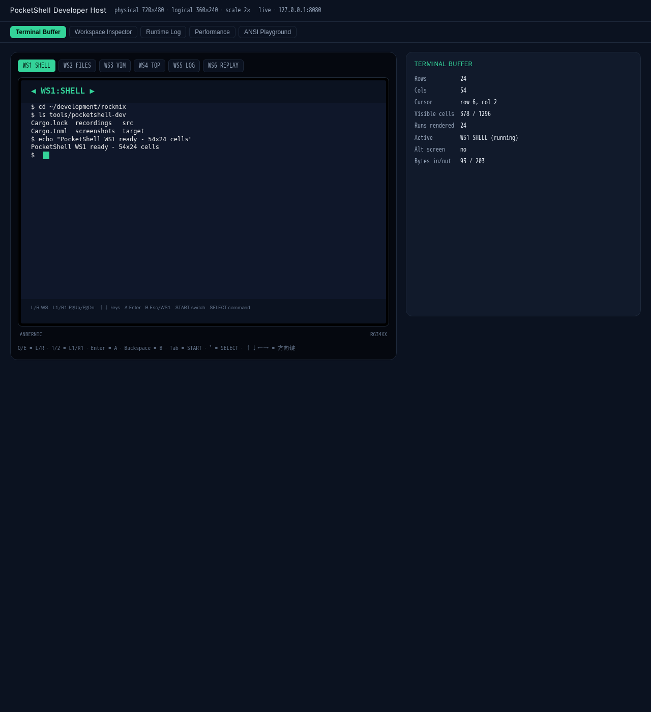

# PocketShell Dev Center

Browser harness for PocketShell's terminal frontend. It runs the same
`pocketshell-terminal.rs` module used by the runtime and exposes it through the
versioned `/ws` protocol plus a browser Dev Center UI. State sync uses cells and
attribute runs; it does not use screenshots.



The panel is presented at its real geometry: 720×480 physical, 360×240 logical,
2× scale. Cells are 12×16 px, giving the device's 54×24 grid.

## Why it exists

Flashing an image to check whether a colour or an escape sequence renders is
slow and gives no visibility into the model. This host keeps the real terminal
model and adds the instruments: dirtied rows, attribute runs, parser output,
workspace lifetimes and per-frame cost.

## Workspace kinds

| Kind | Status | Notes |
|---|---|---|
| Real PTY | implemented | Five live workspaces (`sh`, `ranger`/`lf`, `vim`, `htop`/`top`, log) started once and kept alive across switches |
| Replay | implemented | Timed PTY chunks fed back through the same parser; play/pause/restart/seek |
| Native PocketJS | contract only | Needs the PocketJS runtime and an app bundle; the `Workspace` contract is defined in the firmware `hello/README.md` |

## Running

```sh
cd tools/pocketshell-dev
cargo run --release -- --bind 192.168.1.42 --port 8080   # LAN access
cargo run --release -- --bind 127.0.0.1 --port 8080    # loopback only
```

For RG34XX LAN access, enable the device `pocketshell-dev` service. The page
shows the active LCD scanout and forwards its direction, confirm, back,
shoulder, and START/SELECT controls to the handheld input device.
Open `http://<device-ip>:8080` in a browser on the same LAN. The service exposes
the live LCD frame and a versioned WebSocket endpoint at `/ws`. Public IPv4/IPv6
binds are refused unless `--allow-public` is passed explicitly.

On the H700 device the same binary ships as a systemd service
(`pocketshell-dev.service`, default off). Toggle it with
`rocknix-services set pocketshell-dev.enabled on|off`; the launch wrapper
binds the first private IPv4 address found by `ip -4`.

| Key | Action |
|---|---|
| Q / E | Previous / next workspace |
| 1 / 2 | PageUp / PageDown to the shell |
| Enter | Enter |
| F2 / ` | Open Input Workspace; Escape exits and restores the existing view |
| L / R while open | Cycle ABC / NUM / SYM / PATH layouts |
| PageUp / PageDown while open | Cycle Keyboard / History / Commands / Phrases / Sessions / Agent |
| Character / Backspace / Enter while open | Edit the input buffer; Enter submits the command to the active PTY |
| Tab | Next workspace |
| ` | WS1 |
| Arrows | Arrow keys |
| Ctrl-C | Interrupt |

The Input Workspace is a render overlay. `POST /api/input` accepts `INPUT\tENTER`, `INPUT\tEXIT`, `INPUT\tBUFFER <text>`, `INPUT\tLAYOUT <name>`, `INPUT\tFUNCTION <name>`, `INPUT\tSUBMIT`, `INPUT\tCLEAR`, `INPUT\tDELETE <text>`, and `INPUT\tFAVORITE <text>`. `/api/state` includes an `input` object with `entered`, `previousView`, `buffer`, `layout`, `function`, and submitted `history`.
## WebSocket protocol v1

The browser connects to `ws://<device-ip>:8080/ws` and sends a `hello` envelope.
The server replies with separate sequenced envelopes: `workspace_state`,
`terminal_buffer`, `runtime_state`, `metrics`, `logs`, and `frame_mirror_status`.
A fresh connection or workspace switch starts with a full buffer snapshot
(`full_snapshot: true`); later frames are row deltas. Malformed messages, bad
versions, oversized payloads and out-of-range input produce an `error` envelope.
See `REMOTE_DEV.md` for the full message catalogue.

## Panels

- **Terminal Buffer** — rows, columns, cursor, visible cell count, active
  workspace, alternate-screen state, bytes in/out.
- **Workspace Inspector** — one row per workspace: state, PID, `/dev/pts/N`,
  buffer cells, idle seconds. Proves the PTY survives a switch.
- **Metrics** — FPS, frame time, workspace count, ANSI events, input events,
  buffer size. CPU, memory and network counters are not measured by the host
  and are shown as estimates/unavailable.
- **Logs** — runtime, PTY and renderer events.
- **ANSI Inspector** — paste escape sequences and inspect the resulting cells
  with their exact colours and the parser error count.
- **PTY Inspector** — JSON dump of the active workspace's PID, PTY path,
  state and byte counters.

## Session recording and replay

Browser **Save session.json** records every `workspace_state`,
`terminal_buffer`, `input`, `switch_workspace`, `logs` and `metrics` event with
wall-clock timestamps. Replaying the file through the same state renderer
reproduces the screen without screenshots. Host PTY recording/replay from the
original harness remains available for byte-level ANSI parser demonstrations.

## Frame mirror

Frame mirror is a bounded fallback for programs outside PocketShell. The host
harness reports capture unavailable; no H700 frame capture is claimed or
bundled. See `REMOTE_DEV.md` for the recommended DRM/KMS approach and its
limitations.

## Keys

| Key | Action |
|---|---|
| Arrows | D-pad up/down/left/right |
| Enter | A |
| Escape | B |
| Q / E | L / R |
| 1 / 2 | L1 / R1 |
| Tab | Start |
| `` ` `` | Select |
| X / Y | X / Y buttons |
| other printable keys and Ctrl-C | text into the active workspace |

## Known differences from the device

- `bold` is recorded in the model and currently expressed through colour only:
  the PocketJS `font-mono` slot has no bold weight.
- 24 rows is the panel limit; `top` output longer than that scrolls, exactly as
  it will on hardware.
- Mouse reporting and bracketed paste are not implemented anywhere yet.
- Frame mirror capture is not implemented in this host build; only the protocol
  status response exists.

These are model-level limitations, not host-level ones, so the host does not
hide them.

## Verification

Host harness evidence (no H700 device connected):

```sh
cargo test --release --test protocol
```

That integration test starts the host on an ephemeral loopback port, opens
`/ws`, and asserts versioned ordered envelopes (`workspace_state`,
`terminal_buffer`, `logs`, `runtime_state`, `metrics`), a full first terminal
snapshot, workspace switching to WS3, accepted key/text input, and rejection of
out-of-range input with `error` / `invalid_input`.

Browser evidence: `screenshots/11-*` show a live Chromium session rendering
the 720×480 screen from terminal rows, switching workspaces, and injecting keys
## Screenshots

| File | Shows |
|---|---|
| `01`–`10` | original host harness panels: shell, files, vim, top, log, replay, inspector, performance, runtime log, ANSI playground |
| `11-ws1-shell.png` | live Dev Center shell workspace rendered from terminal rows |
| `11-ws2-files.png` | workspace switch to WS2 through `/ws` |
| `11-remote-input.png` | remote key injection accepted and logged |
| `11-workspace-inspector.png` | PID / PTY / cells / idle for every workspace |
| `11-metrics.png` | FPS, frame time, workspace count, ANSI and input events |
| `11-logs.png` | runtime and PTY lifecycle log |
| `11-ansi-inspector.png` | parsed escape sequences with colour swatches |
| `11-pty-inspector.png` | JSON PTY inspection of the active workspace |
| `11-frame-mirror-poc.png` | frame mirror request answered as capture-unavailable |
| `11-session-recording.png` | session.json recording controls |
## OTA simulator

The **OTA Simulator** tab uses a filesystem root only. It initializes `slot-a`, `slot-b`, and `recovery` fixtures under `${TMPDIR:-/tmp}/pocketshell-ota-sim`; override with `POCKETSHELL_OTA_ROOT`. The checked-in signed local package is under `fixtures/ota`. Check the manifest, stage to the inactive slot, confirm a simulated healthy boot, simulate boot failures (rollback after three), or request rollback from the browser.

The HTTP API exposes `GET /api/ota/status`, `GET /api/ota/log`, `POST /api/ota/check`, `POST /api/ota/install`, `POST /api/ota/confirm`, `POST /api/ota/boot-failure`, and `POST /api/ota/rollback`. Configure fixtures with `POCKETSHELL_OTA_FIXTURE` and a trusted public key with `POCKETSHELL_OTA_PUBLIC_KEY`.

`cargo run -- push 192.0.2.1 --dry-run` exercises local package verification and slot staging without connecting to the address, rebooting, or touching a device. The example address is documentation-only. HTTP remote, local discovery, GitHub Releases, and USB providers are explicitly unsupported. See [docs/ota.md](docs/ota.md) for architecture, state transitions, H700 evidence, and integration gaps. The simulator is not hardware update support.
