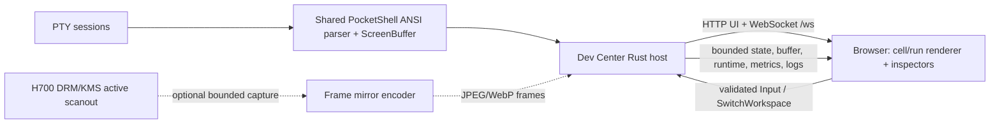

# PocketShell Remote Dev

## Architecture



## Access and trust boundary

On the RG34XX LAN, start the optional `pocketshell-dev.enabled` service, then open `http://<RG34XX_IP>:8080` from a browser on that LAN. For a host harness, run `cargo run --release -- --bind 127.0.0.1 --port 8080` (loopback) or bind an explicit private/device IP. Public addresses are rejected unless `--allow-public` is passed. There is no authentication; do not port-forward.

## Protocol v1

WebSocket endpoint: `/ws`; UTF-8 JSON text frames only. Server envelopes contain `version:1`, monotonically increasing connection-local `seq`, and `type`. Clients send `hello`, `snapshot`, `switch_workspace`, `input`, and `frame_mirror`. The server emits separate `workspace_state`, `terminal_buffer`, `runtime_state`, `metrics`, `logs`, and `frame_mirror_status` messages. First attach and each workspace switch send a full buffer snapshot; later updates carry terminal row deltas. Sequence gaps require a `snapshot` request. Unknown/malformed messages, unsupported versions, invalid input, and oversized payloads return `error` envelopes. Input text is capped at 4096 UTF-8 bytes and rejects control characters.

Client messages:

```json
{"type":"hello","version":1}
{"type":"snapshot"}
{"type":"switch_workspace","workspace":1}
{"type":"input","workspace":0,"key":"UP"}
{"type":"input","workspace":0,"text":"echo ok"}
{"type":"frame_mirror","enabled":true}
```

Server messages observed in the host integration run:

```json
{"version":1,"seq":1,"type":"workspace_state","full_snapshot":true,"state":{"visible":0,"workspaces":[...]}}
{"version":1,"seq":2,"type":"terminal_buffer","full_snapshot":true,"data":"L\\t0\\t...\\nC\\t0\\t...\\n"}
{"version":1,"seq":3,"type":"logs","entries":["Developer Host started"]}
{"version":1,"seq":4,"type":"runtime_state","uptime_s":0}
{"version":1,"seq":5,"type":"metrics","fps":60.0,"frame_ms":0.1,"workspace_count":5,"ansi_events":1,"input_events":0,"cpu_estimate":null,"memory_bytes":null,"network_bytes":null}
{"version":1,"seq":6,"type":"frame_mirror_status","enabled":false,"reason":"DRM capture backend unavailable in this build"}
{"version":1,"seq":7,"type":"error","code":"invalid_input","message":"workspace must be 0..4"}
```


Valid keys include UP/DOWN/LEFT/RIGHT, ENTER, ESC, TAB, BACKSPACE, PGUP/PGDN, HOME/END, CTRL_C/D/L, X/Y/L/R/L1/R1/START/SELECT. The browser maps arrows to D-pad; Enter to A; Escape to B; Q/E to L/R; 1/2 to L1/R1; Tab to Start; backtick to Select; X/Y remain available. Text is UTF-8 and control characters are rejected.

## Modes and metrics

State Sync is the primary mode. Browser rasterizes the same terminal run records from PocketShell's shared parser and ScreenBuffer into a 720×480 canvas. It does not use screenshots. PTY/workspace inspection uses PID, PTY path, state, byte counters, idle duration, buffer geometry, active process and runtime log. FPS/frame time come from the runtime model. CPU, resident memory and network byte counters are not currently measured by the host: UI labels them estimates/unavailable rather than inventing measurements.

Frame Mirror is a fallback for programs outside PocketShell. Research recommends H700 DRM/KMS primary-plane capture when the driver permits readback, otherwise render interception inside the owning SDL/RetroArch process. The target budget is 720×480 JPEG/WebP at no more than 5 fps, one replaceable latest-frame slot, and a 1 MiB encoded-frame cap. The host harness implements only the protocol/status response and reports capture unavailable; it does not produce image frames. DRM scanout planes, overlays, protected content, and driver restrictions can prevent readback. No X11, Wayland, VNC, or RDP dependencies are used. No H700 frame capture is claimed.

## Session recording and replay

Browser **Save session.json** stores timed WorkspaceState, TerminalBuffer, Input and workspace-switch events. Replay consumes those same state/buffer messages through the normal browser renderer; it does not need a recording server or screenshots. Host PTY recording/replay from the original harness remains available for byte-level ANSI parser demonstrations.

## Future integration points

Input Workspace, Command Palette, Agent Workspace, SSH Workspace, and Remote tmux Workspace should each expose the same `WorkspaceState` and `TerminalBuffer` events, declare a workspace kind/ID, and route validated `Input` into their own backend. They must not bypass the shared envelope sequencing or LAN bind policy.
