# PocketShell OTA prototype

## Boundary

This is a filesystem simulator. It does not modify partitions, call `rocknix-update`, reboot the host, or claim device A/B support. The H700 image source creates a FAT32 system/boot partition and one ext4 storage partition (`scripts/mkimage:62-86`). Its U-Boot branch writes `KERNEL`, `SYSTEM`, and checksums to that one FAT volume (`scripts/mkimage:222-237`). H700 selects U-Boot and an MSDOS table (`projects/ROCKNIX/devices/H700/options:24-38`); the bootloader is written to the disk at 8 KiB (`projects/ROCKNIX/bootloader/mkimage:18-21`).

The update script copies device trees to `/flash` and may write DDR4 U-Boot directly to the disk (`projects/ROCKNIX/devices/H700/bootloader/update.sh:18-58`). Initramfs `update_file` remounts `/flash` read/write and copies staged files over their target (`projects/ROCKNIX/packages/sysutils/busybox/scripts/init:395-413`); the boot sequence calls `check_update` before `switch_root` (`init:1297-1310,1373-1374`). The existing `rocknix-update` downloads archive and checksum into `/storage/.update` (`projects/ROCKNIX/packages/rocknix/sources/scripts/rocknix-update:88-129`); those files are applied by that in-place boot path. These sources provide no slot selection or successful-boot commit mechanism. Confirm exact bootloader behavior on hardware before proposing any device integration. **No H700 A/B support is implemented or implied.**

Persistent settings are held on `/storage`; `post-update` syncs configuration while explicitly preserving user service toggles (`projects/ROCKNIX/packages/rocknix/sources/post-update:21-38,201-210`). The simulator mirrors separation only as sample directories; it has no ROCKNIX runtime bindings.

## State machine

```mermaid
stateDiagram-v2
    [*] --> Idle
    Idle --> Verified: signed manifest + size/hash valid
    Verified --> Staging: extract safe regular files to temp inactive slot
    Staging --> Pending: fsync tree, rename slot, atomic state.json replace
    Pending --> Confirmed: health check succeeds; active changes
    Pending --> Pending: boot failure count 1 or 2
    Pending --> RolledBack: boot failure count reaches 3
    Pending --> RolledBack: manual rollback cancels candidate
    Confirmed --> ManualRollback: explicit user action selects prior slot
```

`state.json.tmp` is fsynced and renamed, then the containing directory is fsynced. Slot contents are fully extracted under a temporary sibling and fsynced before directory rename. If interrupted before pending metadata, restart discards candidate and restores any previous slot backup. If pending is durable, restart retains the staged candidate. Confirmation changes active metadata only after caller supplies successful health result. Three failed boot reports clear pending and leave the old active slot selected. Recovery is a separate directory, never an install target; its file hash is checked across staging.

The filesystem protocol approximates crash consistency on local filesystems; it does not prove storage-controller/power-loss behavior. Directory replacement semantics and durability depend on the host filesystem.

## Package and trust policy

Manifest is JSON, versioned by the signed canonical string `pocketshell-ota-v1` followed by newline-separated metadata and changed paths. Ed25519 is verified against an explicitly configured public key. The checked-in sample private key is deleted; fixture verification key is public only. Production key rotation, revocation and secure key storage are unresolved. SHA-256 and exact byte size are checked before extraction. Downgrades and duplicate versions are rejected.

Classifier derives severity from the first path component: workspace (`apps`, `assets`, `themes`, `configs`, `boot.pocket`), runtime (`runtime`, `host`, `renderer`, `ansi`, `terminal`, `pty`), system (`rootfs`, `system`, `services`, `etc`, `usr`), firmware (`kernel`, `boot`, `firmware`, `drivers`). Highest severity wins. The manifest must match classifier output and all policy flags. Workspace requires no reboot/slot switch/rollback/health; runtime requires runtime restart and health; system/firmware require reboot, slot switch, rollback and health.

Archive entries must be regular files with relative paths composed only of normal components; absolute paths, `..`, backslashes, links, directories and special files are rejected. Files are created exclusively beneath an empty candidate directory. No archive path is joined to active or recovery.

## Providers and interfaces

`OTAProvider` defines manifest and package retrieval. Local fixture provider is implemented. HTTP currently reports unsupported because no configured TLS transport, trust-key setting or remote manifest endpoint exists. GitHub Releases, USB and multicast DNS discovery report unsupported; they do not return fake updates. The sample fixture is signed and contains only `apps/demo.txt`.

`pocketshell-dev push <device-ip> --dry-run` uses the fixture and filesystem simulator. It reports build skipped (host fixture), then classification, package verification, staging and simulated handoff. It never contacts the IP or reboots.

## Integration gap

Device support needs a bootloader with redundant system slots, authenticated slot selection, persistent attempt counters and an atomic successful-boot commit, plus partition/layout migration and recovery design. ROCKNIX H700 source evidence currently shows in-place writes, so a firmware update through that path would violate the safety invariant. Do not connect this simulator to device paths until those mechanisms are implemented and power-loss tested.
